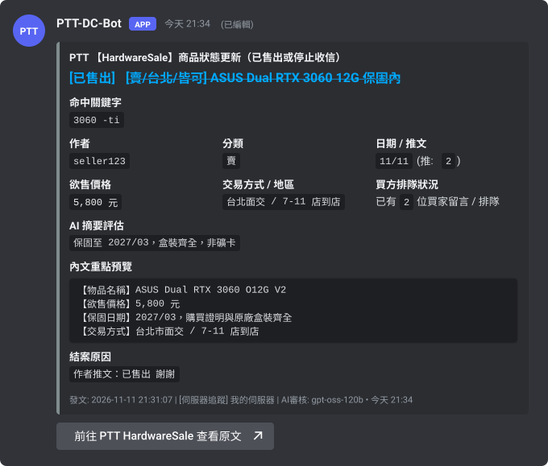
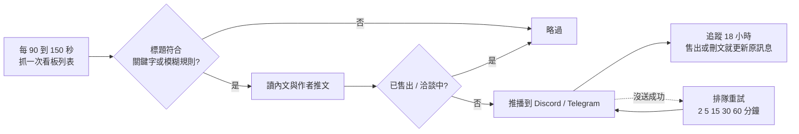

# PTT-DC-Bot

[English](README_EN.md) | **繁體中文**

[](https://github.com/jasonxp516/ptt-dc-bot/actions/workflows/ci.yml)
[](https://github.com/jasonxp516/ptt-dc-bot/releases/latest)
[](https://www.python.org/)
[](https://github.com/jasonxp516/ptt-dc-bot/pkgs/container/ptt-dc-bot)
[](LICENSE)

盯著 PTT 二手交易看板，有符合條件且還沒賣掉的新文章就通知你的機器人。通知送到 Discord 或 Telegram，商品賣掉後會直接把原本那則通知劃掉。

<p align="center">
  
</p>

**目錄**：[能做什麼](#能做什麼) · [開始前準備](#開始前準備) · [安裝](#安裝) · [五分鐘上手](#五分鐘上手) · [關鍵字寫法](#關鍵字寫法) · [指令](#指令) · [通知平台](#通知平台) · [設定項](#設定項) · [運作方式](#運作方式) · [升級與備份](#升級與備份) · [疑難排解](#疑難排解) · [已知限制](#已知限制)

---

## 能做什麼

- **只通知還買得到的**：推播前會讀內文與作者推文，已售出、洽談中、請勿來信的文章不會通知。
- **賣掉會劃線**：通知送出後持續追蹤 18 小時，售出或刪文時直接更新原本那則訊息，不會再洗一則。
- **看得懂合售文**：一篇文章賣好幾樣東西時，只看你追蹤的那一樣有沒有賣掉、價格多少。
- **預算過濾不被型號騙**：`RTX 3060`、`12G`、`750W` 這類數字不會被當成價格，`5.8k` 會換算成 5800。
- **用講的也可以**：設定 Groq API Key 後，可以直接對機器人說「幫我追 6500 以內有保固的 3060 Ti」。
- **伺服器共用或個人私訊**：同一個機器人可以服務多個伺服器與多位使用者，每個人的規則各自獨立。
- **沒送到會補送**：頻道暫時無法發言或網路中斷時，通知會排隊重試。

<p align="center">
  
</p>

## 開始前準備

| 項目 | 必要 | 取得方式 |
| :--- | :--- | :--- |
| Discord Bot Token | 是 | 到 [Discord Developer Portal](https://discord.com/developers/applications) 建立應用程式，在 Bot 頁面按 Reset Token |
| 執行環境 | 是 | Python 3.10 以上，或 Docker |
| Groq API Key | 否 | 到 [Groq Console](https://console.groq.com/keys) 免費申請。沒有也能用，只是少了 AI 語意判斷、模糊規則與 `/ai` 對話 |

邀請機器人時的設定：

- Scopes 勾選 `bot` 與 `applications.commands`，權限整數 `274877975552`（View Channels、Send Messages、Embed Links、Read Message History）。
- **不需要**開啟任何 Privileged Gateway Intents，也**不需要** Message Content Intent。

## 安裝

**Linux / macOS**

```bash
curl -fsSL https://raw.githubusercontent.com/jasonxp516/ptt-dc-bot/main/install.sh | bash
```

**Windows (PowerShell)**

```powershell
irm https://raw.githubusercontent.com/jasonxp516/ptt-dc-bot/main/install.ps1 | iex
```

腳本會建立虛擬環境、安裝套件，然後啟動設定精靈問你 Token。想先看腳本內容，可以把網址下載成檔案檢查後再執行。

**Docker**

```bash
mkdir -p ptt-dc-bot/data && cd ptt-dc-bot
curl -fsSL https://raw.githubusercontent.com/jasonxp516/ptt-dc-bot/main/docker-compose.yml -o docker-compose.yml
curl -fsSL https://raw.githubusercontent.com/jasonxp516/ptt-dc-bot/main/.env.example -o .env
chmod 600 .env        # 編輯 .env，至少填入 DISCORD_TOKEN
docker compose up -d
```

其他部署方式（文件為英文）：[Docker 詳細說明](docs/deploy-docker.md) · [Synology DSM](docs/deploy-synology.md) · [unRAID](docs/deploy-unraid.md) · [Linux systemd / tmux](docs/deploy-linux.md)

## 五分鐘上手

以下圖片皆為示意圖，內容與實際畫面的文字相同。

**1. 在要收通知的頻道輸入 `/setup`**，按「綁定此頻道為推播頻道」。想收私訊就直接私訊機器人輸入 `/setup`。

<p align="center">
  
</p>

**2. 從下拉選單勾選要盯的看板。** 清單外的看板可以用 `/board_add` 加入。

<p align="center">
  
</p>

**3. 按「新增追蹤關鍵字」**，填入關鍵字與預算上限。

<p align="center">
  
</p>

**4. 按「測試推播通知」**，確認頻道收得到卡片。之後有符合的新文章就會自動通知。

## 關鍵字寫法

| 輸入 | 意思 |
| :--- | :--- |
| `3060` | 標題含 3060 |
| `3060 台北` | 同時含 3060 與台北（空格代表「而且」） |
| `3060 -ti -筆電` | 含 3060，但不含 ti 也不含筆電 |
| `4070 super`，預算上限 `18000` | 含 4070 與 super，且售價不超過 18000 |

- 比對的是文章標題，不分大小寫，`3060Ti` 與 `3060 Ti` 視為相同。
- 分類預設是 `賣`，可改成 `徵`、`換`、`情報` 或 `ALL`。
- 文章沒標價格時不會被預算擋掉，仍會通知。

**精確關鍵字與 AI 模糊規則怎麼選**：知道型號就用關鍵字（`/keyword_add`），快又不耗 AI 額度。條件難用關鍵字表達時用模糊規則（`/fuzzy_add`），例如「有保固、台北面交的雙風扇顯卡」，需要 Groq API Key。

## 指令

**日常使用**

| 指令 | 說明 |
| :--- | :--- |
| `/setup` | 開啟設定面板（首次使用從這裡開始） |
| `/keyword_add` `/keyword_edit` `/keyword_remove` | 新增、修改、移除精確關鍵字 |
| `/keyword_list` `/keyword_clear` | 查看全部規則、清空關鍵字 |
| `/fuzzy_add` `/fuzzy_remove` `/fuzzy_list` | 管理 AI 模糊規則 |
| `/board_add` `/board_remove` `/board_list` | 管理盯梢的看板（支援中文別名，如 相機、筆電、蘋果） |
| `/channel_set` | 更換推播頻道 |
| `/push_mode` | 切換「只推符合條件」或「推看板所有新文章」 |
| `/pause` `/resume` | 暫停或恢復通知（規則保留） |
| `/ai` | 用自然語言請 AI 設定規則、找看板、掃描現貨 |
| `/scan_unsold` | 回頭掃描版上還沒賣掉的商品 |
| `/search` | 用 PTT 搜尋功能查看板文章 |
| `/check_now` | 立刻巡檢一次 |
| `/status` `/me` `/help` | 機器人狀態、個人設定與額度、使用教學 |
| `/forget_me` | 永久刪除自己的規則、推播紀錄與對話記憶 |

多數指令有 `scope` 參數，可選「個人」或「伺服器共用」。修改伺服器共用規則需要管理伺服器或管理頻道權限。直接私訊或在頻道 @機器人 也能用自然語言對話。

**擁有者專用**

| 指令 | 說明 |
| :--- | :--- |
| `/admin` | 查看所有訂閱者、調整額度等級、管理黑名單 |
| `/email_copy` | 開關 Email 副本 |

**Telegram**

`/start` · `/keyword_add` · `/keyword_list` · `/keyword_remove` · `/pause` · `/resume` · `/status` · `/me` · `/forget_me` · `/help`

```text
/keyword_add 3060Ti 7000                    看板預設 HardwareSale、分類預設 賣
/keyword_add MacShop 賣 macbook 30000       指定看板與分類
```

## 通知平台

**Discord**（必要）：伺服器頻道與個人私訊都支援，功能最完整。

**Telegram**（選用）

1. 向 [@BotFather](https://t.me/BotFather) 申請 Token。
2. `.env` 設定 `ENABLE_TELEGRAM=true` 與 `TELEGRAM_BOT_TOKEN`，重啟機器人。
3. 私訊你的 Telegram 機器人或把它加進群組，輸入 `/start`。

不需要公開 IP 或網域。群組裡只有群組管理員（或 `TELEGRAM_ADMIN_USER_ID` 名單）能改設定。Telegram 目前只支援精確關鍵字，沒有模糊規則與 AI 對話。

**Email**（選用，副本模式）：把 Discord 或 Telegram 送出的通知同時寄一份到信箱。

1. `.env` 設定 `ENABLE_EMAIL=true`、`SMTP_HOST`、`SMTP_USER`、`SMTP_PASSWORD`、`EMAIL_TO`，重啟機器人。Gmail 要用 16 碼的應用程式密碼。
2. 擁有者在 Discord 執行 `/email_copy`，選「開啟」。機器人會先寄一封測試信，寄成功才算開啟。

## 設定項

所有設定寫在專案目錄的 `.env`，修改後要重啟。完整範本見 [.env.example](.env.example)。

| 設定 | 預設 | 說明 |
| :--- | :--- | :--- |
| `DISCORD_TOKEN` | 無（必填） | Discord Bot Token |
| `OWNER_USER_ID` | 自動偵測 | 擁有者的 Discord 使用者 ID，可用 `/admin` 與 `/email_copy` |
| `DEFAULT_GUILD_ID` `DEFAULT_CHANNEL_ID` | 空 | 主伺服器與預設推播頻道，也可以用 `/setup` 設定 |
| `GROQ_API_KEY` | 空 | 留空則不使用 AI，只用規則判斷 |
| `GROQ_MODELS` | 空 | 逗號分隔的模型清單；Groq 下架模型時用它更換 |
| `POLL_INTERVAL_MIN` `POLL_INTERVAL_MAX` | `90` `150` | 每輪巡檢的間隔秒數範圍，最低 30 |
| `MAX_ARTICLE_AGE_HOURS` | `24` | 超過這個時數的舊文章不推播；停機後補推也以此為限 |
| `DEFAULT_BOARD` | `HardwareSale` | 預設看板 |
| `BOT_LANGUAGE` | `zh_TW` | 設定面板語言，可改 `en` |
| `ENABLE_TELEGRAM` `TELEGRAM_BOT_TOKEN` | `false` 空 | 啟用 Telegram |
| `TELEGRAM_ADMIN_USER_ID` | 空 | 可管理任何群組規則的 Telegram 使用者 ID |
| `TELEGRAM_BLOCKED_USER_IDS` | 空 | 機器人完全不回應的 Telegram 使用者 ID |
| `ENABLE_EMAIL` `SMTP_*` `EMAIL_TO` | `false` | Email 副本的寄信設定與收件信箱 |

多個 ID 以逗號分隔。

## 運作方式



- 不管有多少人使用，每個看板每輪只抓一次，文章內文也會快取，不會因為使用者變多而增加被 PTT 限流的機會。
- 被 PTT 限流時會自動暫停並逐步拉長等待時間，恢復後繼續。
- 機器人停機後重新啟動，會往回補抓最多 5 頁、24 小時內的文章。
- 售出判斷先用規則（標題、內文、作者推文），有 Groq API Key 時再用 AI 複核。AI 不可用時自動退回純規則。

## 升級與備份

**升級**

```bash
# Docker
docker compose pull && docker compose up -d

# 一行安裝（以 git 下載的情況）：更新後重新啟動機器人
cd ~/ptt-dc-bot && git pull && ./venv/bin/pip install -r requirements.txt
```

沒有用 git 的話，下載[最新版安裝包](https://github.com/jasonxp516/ptt-dc-bot/releases/latest)覆蓋程式檔即可，`.env` 與 `bot_data.db` 保留不動。資料庫會在啟動時自動升級。各版本變更見 [CHANGELOG.md](CHANGELOG.md)。

**資料與備份**

- 所有資料在 `bot_data.db`（Docker 為 `data/bot_data.db`）。
- 每天自動備份到同目錄的 `backups/`，保留最近 7 份。
- 還原：停止機器人，把備份檔複製回來並改名為 `bot_data.db`，再啟動。

## 疑難排解

| 狀況 | 處理方式 |
| :--- | :--- |
| 打 `/` 看不到指令 | 新指令同步到 Discord 可能要幾分鐘到一小時；確認邀請時有勾 `applications.commands` |
| 沒收到通知 | 用 `/status` 看巡檢是否正常、是否被 `/pause`；確認機器人在該頻道有發言與嵌入連結權限；關鍵字條件是否太嚴 |
| `/status` 顯示看板異常或冷卻中 | PTT 暫時限流，會自動恢復。連續失敗 5 次與恢復時都會通知擁有者 |
| AI 沒反應，或收到「Groq 模型設定需要更新」 | 模型被 Groq 下架。在 `.env` 的 `GROQ_MODELS` 填入可用模型後重啟 |
| Telegram 完全沒反應 | 看日誌：Token 錯誤會停止連線；`409 Conflict` 表示同一個 Token 有兩個程式在跑，關掉其中一個 |
| Docker 顯示 unhealthy | 確認 `data/` 目錄容器寫得進去（執行帳號 UID 為 1000） |
| 想看詳細錯誤 | 日誌在 `bot.log`（Docker：`docker compose logs -f`） |

## 已知限制

- 一定要有 Discord Bot Token 才能啟動，目前無法只跑 Telegram。
- Telegram 只支援精確關鍵字。
- Email 只是副本，已寄出的信無法在商品售出後更新。
- 新增訂閱前後約兩分鐘內發表的文章，可能多通知或少通知一篇。
- 比對只看標題；內文才提到的型號要靠 AI 模糊規則。
- 本專案與 PTT 官方無關。請維持預設的巡檢間隔，不要對 PTT 造成負擔。

## 隱私

機器人只儲存訂閱者 ID、追蹤規則、14 天內的推播紀錄，以及 30 分鐘內的 AI 對話記憶。使用者可以隨時用 `/forget_me` 刪除自己的資料。詳見 [PRIVACY.md](PRIVACY.md)。

## 開發與測試

```bash
git clone https://github.com/jasonxp516/ptt-dc-bot.git && cd ptt-dc-bot
python3 -m venv venv && ./venv/bin/pip install -r requirements.txt pytest pyyaml
./venv/bin/pytest -q                      # 全部離線執行，不會連到 PTT 或 Discord
./venv/bin/python tools/eval_sold.py      # 售出判斷基準測試（80 筆樣本）
./venv/bin/python tools/gen_readme_assets.py   # 介面文字有改時，重新產生 assets/ 的示意圖
```

## 授權

[MIT License](LICENSE)
