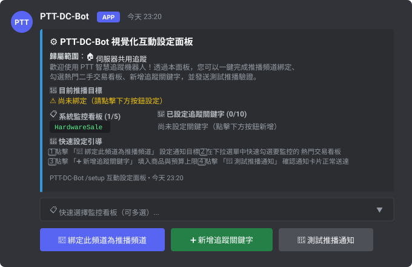
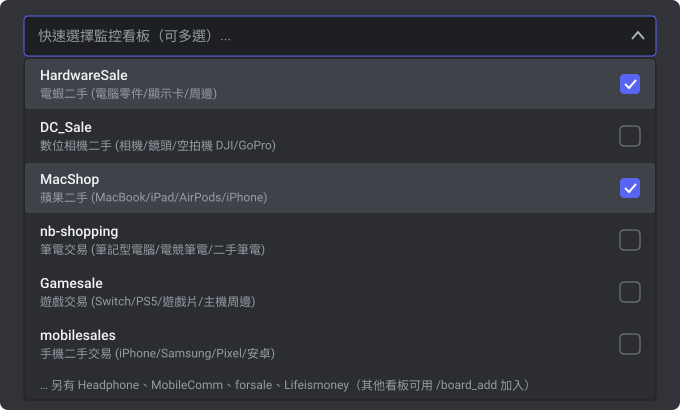
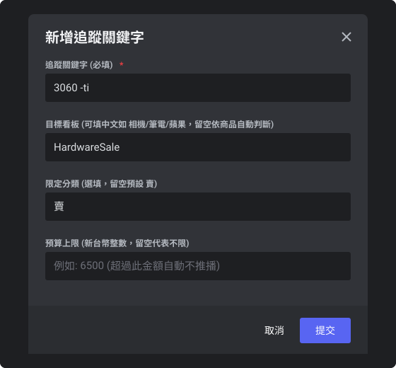
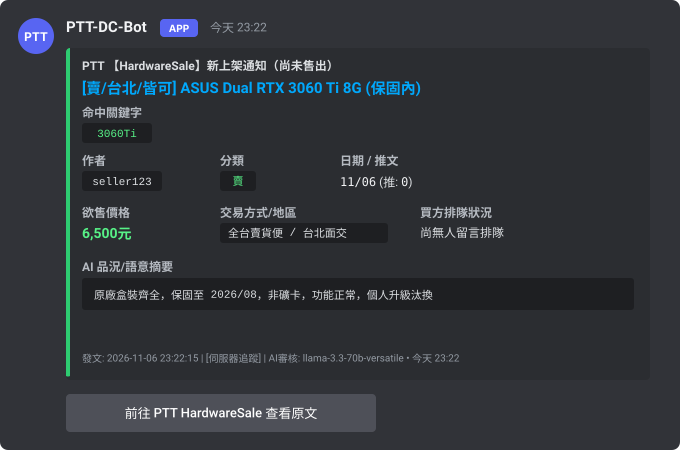

# PTT-DC-Bot

[English](README_EN.md) | **繁體中文**

[](https://www.python.org/)
[](https://discordpy.readthedocs.io/)
[](https://groq.com/)
[](https://github.com/jasonxp516/ptt-dc-bot/pkgs/container/ptt-dc-bot)
[](https://www.sqlite.org/wal.html)
[](LICENSE)

結合規則過濾與 Groq LLM 語意判讀的 PTT 看板監控與 Discord 推播機器人。
主要針對 `HardwareSale`（電蝦二手）、`MacShop`（蘋果二手）、`nb-shopping`（筆電交易）、`Gamesale`（遊戲交易）、`MobileComm`（手機通訊）等買賣看板設計，解決傳統推播工具常見的「點進去才發現已售出」、「合售文被誤判結案」與「型號數字被當成售價」等問題。

---

## 為什麼做這個專案？（核心功能特色）

市面上常見的 PTT 推播工具大多僅做「標題關鍵字比對 + 單向發送訊息」。在二手交易看板實際使用時，往往面臨資訊過期與誤報困擾。本專案針對這些痛點設計了專門機制：

1. **已售出自動原位更新（In-place Update）**  
   推播後持續追蹤該貼文 18 小時，穿透檢查簽名檔下方**作者本人的最新推文**（如「已售出」、「暫售」、「洽中」）。確認售出後**直接編輯原本的 Discord 通知卡片加上刪除線**，不重複洗版。
2. **多品項合售文獨立解析**  
   一篇貼文同時販售多樣商品時（例如：`1. GTX 1060 (已售出) / 2. RTX 3060Ti $5800`），一般爬蟲偵測到內文含「已售出」就會略過整篇。本工具會為不同關鍵字切出獨立視角，各自判斷售出狀態與對應價格。
3. **硬體型號與價格消歧義**  
   內建型號遮蔽規則，不會將標題或內文的 `RTX 3060`、`12G`、`750W`、`i5-12400` 誤判為售價；支援 `5.8k` 等常見簡寫換算與預算上限過濾。
4. **自然語言設定與語意審核（免付費 API 成本）**  
   整合免費 Groq API，支援直接以白話文交辦規則（例如：「幫我追 6500 元以內、有原廠保固的 3060Ti」）。底層透過 3 個免費模型建立動態輪替池（合計 24,000 TPM）與 P0~P3 優先級佇列，確保背景巡檢不觸發 Rate Limit。
5. **單一實例支援「伺服器公用」與「個人私訊（DM）」**  
   採用 SQLite WAL 多租戶架構。同一個 Bot 可在伺服器公用頻道推播，成員也能直接私訊 Bot 建立私人追蹤清單，規則與配額彼此完全隔離。

<details>
<summary><b>點擊展開：與現有常見方案的功能對照表（PttAlertor / Webhook / RSS）</b></summary>
<br>

| 評估項目 | 傳統 Webhook 腳本 | PttAlertor | RSS 訂閱機器人 | **PTT-DC-Bot (本專案)** |
| :--- | :--- | :--- | :--- | :--- |
| **互動方式** | 單向推播，需手動改設定檔 | LINE / TG 指令 | Slash 指令 (僅綁網址) | **原生 `/setup` 視覺化 UI + 自然語言對話 + 翻頁按鈕** |
| **多租戶隔離** | 無 (單一設定) | 依帳號區分 | 依頻道區分 | **支援伺服器頻道公用 + 個人私訊獨立規則** |
| **已售出判定** | 僅檢查標題文字 | 僅檢查標題或無 | 無 | **標題正則 + 簽名檔後作者推文 + LLM 語意複審** |
| **過時訊息處理** | 不處理 | 不處理 | 不處理 | **18 小時內自動原位編輯卡片並加上刪除線** |
| **多品項合售文** | 整篇統一判斷 | 整篇統一判斷 | 無 | **依關鍵字切分獨立品項狀態與對應售價** |
| **價格上限過濾** | 簡易正則 (易誤判型號) | 無 | 無 | **排除硬體型號干擾，支援 `k` 單位換算與預算過濾** |
| **歷史現貨搜尋** | 無 | 無 | 無 | **提供 `/scan_unsold` 回溯掃描版上尚未售出的商品** |
| **爬蟲請求最佳化** | 依規則重複抓取 | 集中爬取 | 依賴 RSS 來源頻率 | **單次爬取多租戶共享快取 (Crawl-Once, Fan-Out)** |

</details>

---

## 快速開始：三大部署方式（三選一）

在開始之前，請先準備好兩項免費金鑰：
1. **Discord Bot Token**：至 [Discord Developer Portal](https://discord.com/developers/applications) 建立 Application，在「Bot」分頁點擊 **Reset Token** 取得金鑰；**請務必在下方開啟 `Message Content Intent`**。
2. **Groq API Key（免費）**：至 [Groq Console](https://console.groq.com/keys) 註冊並點擊 **Create API Key** 取得金鑰（格式為 `gsk_...`）。

---

### 方式一：一行指令自動安裝與引導（推薦）

打開終端機（Terminal 或 PowerShell），貼上對應系統的一行指令即可自動完成「下載專案 -> 建立虛擬環境 -> 安裝相依套件 -> 啟動互動設定精靈 -> 產生邀請網址 -> 啟動服務」：

#### Linux / macOS
```bash
curl -fsSL https://raw.githubusercontent.com/jasonxp516/ptt-dc-bot/main/install.sh | bash
```

#### Windows (PowerShell)
```powershell
irm https://raw.githubusercontent.com/jasonxp516/ptt-dc-bot/main/install.ps1 | iex
```

*特點說明*：
- 自動檢測 Python 3.10+ 環境（若系統缺少 Python，Windows 腳本會提示透過 winget 自動安裝）。
- 自動建立獨立虛擬環境（`.venv`），不污染全域環境。
- 自動進入終端機設定精靈，依畫面提示貼上 Token 與 Key 即可。
- 安裝完成後提供立即啟動選項（Linux 支援選擇以 tmux 背景常駐運行）。

---

### 方式二：GitHub Releases 雙擊即開免安裝包

不習慣使用終端機指令的使用者，可直接下載官方打包發行的免安裝壓縮包：

1. 前往專案的 [GitHub Releases 發行頁面](https://github.com/jasonxp516/ptt-dc-bot/releases) 下載最新版本檔案：
   - **Windows**：下載 `ptt-dc-bot-<版本>-windows.zip`
   - **macOS**：下載 `ptt-dc-bot-<版本>-macos.tar.gz`
   - **Linux**：下載 `ptt-dc-bot-<版本>-linux.tar.gz`（例如 `ptt-dc-bot-v1.0.0-beta.1-linux.tar.gz`）
2. 將壓縮檔解壓縮至任意目錄（例如桌面或個人資料夾，Linux 可使用 `tar -xzf ptt-dc-bot-*-linux.tar.gz` 解壓縮）。
3. 執行啟動器：
   - **Windows**：滑鼠雙擊 **`start_windows.bat`**
   - **macOS**：滑鼠雙擊 **`start_mac.command`**
   - **Linux**：終端機進入解壓縮目錄執行 **`./install.sh`** 進行初始化設定（或執行 `./start_bg.sh` 常駐啟動 / `python3 bot.py` 前台執行）
4. 首次執行時會自動初始化環境並彈出設定精靈，依指示貼上金鑰後即自動連線啟動。

*守護機制*：
- Windows 啟動器內建自動守護迴圈：若遇到網路瞬斷或程式異常退出，會在 10 秒後自動嘗試重新連線；關閉視窗或在設定階段終止則會乾淨停止。

---

### 方式三：Docker Compose 與 GHCR 預建映像檔

適合 Linux 伺服器、樹莓派、家用主機或 NAS（Synology / unRAID / QNAP）容器化部署。官方提供多架構（AMD64 / ARM64）自動建置映像檔：`ghcr.io/jasonxp516/ptt-dc-bot:latest`。

#### 1. 標準 Docker Compose 部署

建立工作目錄並準備設定檔：

```bash
mkdir -p ptt-dc-bot/data && cd ptt-dc-bot

# 下載官方 docker-compose.yml 與設定範本
curl -fsSL https://raw.githubusercontent.com/jasonxp516/ptt-dc-bot/main/docker-compose.yml -o docker-compose.yml
curl -fsSL https://raw.githubusercontent.com/jasonxp516/ptt-dc-bot/main/.env.example -o .env

# 設定安全權限並編輯金鑰
chmod 600 .env
nano .env
```

在 `.env` 中填入憑證：
```ini
DISCORD_TOKEN=填入你的_discord_bot_token
GROQ_API_KEY=填入你的_groq_api_key
```

啟動容器：
```bash
# 取得最新預建映像檔並於背景啟動
docker compose pull && docker compose up -d

# 檢視即時運行日誌（出現 Logged in as ... 即代表成功）
docker compose logs -f

# 停止服務
docker compose down
```

`docker-compose.yml` 預設配置已啟用最小權限（`cap_drop: ALL`、`no-new-privileges: true`）、資源限制（1.0 CPU、512MB RAM）以及資料庫持久化掛載（`./data:/app/data`）。

---

#### 2. 群暉 Synology NAS (Container Manager) 部署步驟

1. **準備目錄與設定檔**：
   - 開啟 DSM 的 **File Station**，在 `docker` 共用資料夾下建立目錄結構：
     ```text
     /docker/ptt-dc-bot/
     ├── .env           (文字檔，填入 DISCORD_TOKEN 與 GROQ_API_KEY)
     └── data/          (空目錄，供 SQLite 資料庫與日誌持久化儲存)
     ```
2. **建立專案 (Container Manager)**：
   - 開啟 **Container Manager** 應用程式，切換至「**專案 (Project)**」分頁。
   - 點擊「**新增 (Create)**」：
     - **專案名稱**：`ptt-dc-bot`
     - **路徑**：選取剛才建立的 `/docker/ptt-dc-bot`
     - **來源**：選擇「建立 docker-compose.yaml」，並貼入專案的 `docker-compose.yml` 內容。
   - 點擊下一步，Container Manager 將自動下載 `ghcr.io/jasonxp516/ptt-dc-bot:latest` 映像檔並啟動容器。
3. **確認運行**：
   - 點選該容器的「詳細資訊」->「日誌」，確認輸出 `Logged in as ...` 即可。

---

#### 3. unRAID 容器化部署步驟

1. 進入 unRAID Web 管理介面，切換至 **Docker** 分頁，滑到最下方點擊 **Add Container**。
2. 填寫容器參數：
   - **Name**：`ptt-dc-bot`
   - **Repository**：`ghcr.io/jasonxp516/ptt-dc-bot:latest`
   - **Restart Policy**：`unless-stopped`
3. 點擊 **Add another Path, Port, Variable, or Device** 加入以下配置：
   - **目錄掛載 (Path)**：
     - Container Path: `/app/data`
     - Host Path: `/mnt/user/appdata/ptt-dc-bot`
     - Access Mode: `Read/Write`
   - **環境變數 (Variable)**：
     - Name: `DISCORD_TOKEN`, Value: `你的 Discord Token`
     - Name: `GROQ_API_KEY`, Value: `你的 Groq API Key`
     - Name: `TZ`, Value: `Asia/Taipei`
4. 點擊 **Apply**，容器建置完成後即自動於背景常駐運行。

---

## Discord 首次啟動引導與 `/setup` 視覺化 UI 操作指南

機器人成功啟動後，後續的頻道設定、看板訂閱與關鍵字管理完全可以在 Discord 介面內透過視覺化按鈕與選單完成，無需記憶任何複雜指令。

### 1. 將機器人加入伺服器（OAuth2 權限說明）

- **自動產生的專屬邀請連結**：  
  若您使用安裝腳本或雙擊啟動器，設定精靈驗證 Token 成功後會直接在終端機印出帶有權限整數 `274877975552` 的專屬邀請網址。點開該網址並選擇您的伺服器即可完成授權。
- **手動邀請權限確認**：  
  若自建邀請網址，請確認包含 Scopes：`bot` 與 `applications.commands`；Bot Permissions 需包含：
  - `View Channels`（檢視頻道）
  - `Send Messages`（發送訊息）
  - `Embed Links`（嵌入連結，卡片排版必備）
  - `Read Message History`（讀取歷史訊息）

> **[重要提醒]**：請務必至 [Discord 開發者後台](https://discord.com/developers/applications) -> 你的 Bot -> **Bot** 分頁 -> **Privileged Gateway Intents**，將 **Message Content Intent** 開啟並儲存。若未開啟此選項，機器人將無法讀取訊息內容與私訊對話。

---

### 2. 首次連線自動私訊引導 (Clean Boot Welcome DM)

當機器人首次登入且系統處於全新安裝狀態（尚未綁定任何推播頻道且無關鍵字）時：
1. 終端機會印出顯著的提示訊息：
   ```text
   ========================================================================
   [PTT-DC-Bot] 首次啟動導引：
   機器人已成功登入！請在 Discord 伺服器或私訊中輸入 /setup 快速完成推播與看板設定。
   ========================================================================
   ```
2. 機器人會主動向 Application Owner（機器人建立者）發送一則歡迎私訊，提供快速開始 4 步驟教學與核心指令摘要。

---

### 3. `/setup` 視覺化互動面板操作流程

在目標伺服器文字頻道中輸入 `/setup`（或直接在機器人的私訊視窗中輸入 `/setup`），即可喚出視覺化控制面板：

<p align="center">
  
</p>

面板四大操作步驟：

1. **第一步：點擊「綁定此頻道為推播頻道」按鈕**  
   - 一鍵將目前所在的文字頻道設為推播目標。
   - 若在與機器人的私訊（DM）視窗點擊，則會直接設定為個人專屬私訊推播。
2. **第二步：在「快速選擇監控看板」下拉選單勾選看板**  
   - 下拉選單已預載社群最熱門的二手交易看板：
     - `HardwareSale`：電蝦二手（桌機零組件、顯示卡、周邊設備）
     - `MacShop`：蘋果二手（MacBook、iPhone、iPad、原廠配件）
     - `nb-shopping`：筆電交易（各廠牌二手筆記型電腦）
     - `Gamesale`：遊戲交易（家用主機、Switch / PS5 遊戲片）
     - `MobileComm`：手機通訊（各大品牌智慧型手機、通訊周邊）
   - 支援單選或多選，勾選後系統立即建立文章基準線，避免舊文洗版。

<p align="center">
  
</p>

3. **第三步：點擊「新增追蹤關鍵字」按鈕（彈出 Modal 表單）**  
   - 點擊後彈出表單視窗，填寫以下欄位：
     - **追蹤關鍵字（必填）**：支援多詞空格（AND 邏輯，如 `3060Ti 台北`）與減號排除（如 `3060 -筆電 -礦`）。
     - **目標看板（選填）**：預設為 `HardwareSale`，可自行指定其他看板。
     - **限定分類（選填）**：預設為 `賣`（僅過濾販售文章，排除徵求文）。
     - **預算上限（選填）**：填入純數字（如 `6500`），文章標價高於此金額時自動過濾不推播。

<p align="center">
  
</p>

4. **第四步：點擊「測試推播通知」按鈕**  
   - 機器人會立即向已綁定的推播目標發送一張格式完整的測試通知 Embed 卡片。
   - 藉此確認 Bot 是否具備該頻道的發言權限，以及卡片排版是否正常送達。

<p align="center">
  
</p>

---

## 日常使用方式

PTT-DC-Bot 同時支援**「個人私訊 (DM)」**與**「伺服器公用頻道」**雙模式：
- **個人私訊專屬追蹤**：直接私訊機器人或在私訊中執行 Slash 指令，推播將直接發送至個人私訊，無需任何伺服器管理權限。
- **伺服器公用頻道推播**：伺服器管理員透過 `/setup` 或 `/channel_set` 綁定頻道，該伺服器設定的所有規則均會推播至指定頻道。

### 1. 自然語言交辦（私訊直接對話 或 `/ai`）

除了視覺化按鈕，你也可以直接像跟真人助理對話一樣交辦需求，AI 會自動辨識意圖並調用後端工具：
- `"幫我追蹤 HardwareSale 板販售的 4070S，預算 18000 元以內"`
- `"我想找台北面交、還有原廠保固的 3060Ti，預算 6500"`
- `"幫我掃描目前 HardwareSale 板上還沒賣掉的 6700XT"`
- `"列出我目前設定的所有追蹤條件"`

### 2. 精確關鍵字語法重點（`/keyword_add`）
- **空白代表 AND**：`台北 3060TI`（標題需同時包含「台北」與「3060TI」）。
- **減號 `-` 代表排除**：`3060 -ti -筆電 -礦`（找純 3060，排除 3060Ti、筆電與礦卡）。
- **預算上限（`max_price`）**：填入金額數值（例如 `6000`），自動排除標價高於該金額的貼文。

### 3. AI 模糊語意追蹤規則（`/fuzzy_add`）
針對無法單純靠標題關鍵字判斷的複雜條件（如：保固期限、盒裝完整度、特定交易地點）：
- `description`：以白話文描述追蹤條件（例如：`RTX 3060Ti 有原廠盒裝且在保固內，非礦卡`）。
- `hint_keywords`（*建議填寫*）：快速初篩關鍵字（例如：`3060,3060ti`），僅在文章標題符合初篩時才調用 LLM 進行深度語意審核，大幅提升處理效率。

### 4. 主動回溯掃描現貨（`/scan_unsold`）
剛設好規則不想枯等新文章？執行 `/scan_unsold keyword: 3060TI`，系統會自動往回檢索近期文章，穿透作者最新推文過濾掉已售出或已結案的貼文，整理成附帶翻頁按鈕的現貨清單。

---

## 進階配置與系統管理（點擊展開）

以下整理完整指令清單、背景守護服務設定、環境變數與內部架構細節：

<details>
<summary><b>1. 完整 25 組 Slash 指令手冊</b></summary>
<br>

#### 視覺化設定與 AI 搜尋
| 指令 | 參數 | 說明 |
| :--- | :--- | :--- |
| `/setup` | `scope` | 開啟視覺化互動設定面板（一鍵綁定頻道、熱門看板下拉選單、新增關鍵字 Modal、測試推播） |
| `/ai` | `prompt`, `scope` | 以自然語言指示 AI 新增規則、查詢看板或回溯搜尋現貨 |
| `/scan_unsold` | `keyword`, `board`, `max_per_keyword` | 回溯掃描看板近期貼文，過濾出尚未售出的商品清單（附翻頁按鈕） |
| `/search` | `keyword`, `board`, `pages` | 呼叫 PTT 原生搜尋查詢歷史文章（不過濾售出狀態） |

#### 精確關鍵字管理
| 指令 | 參數 | 說明 |
| :--- | :--- | :--- |
| `/keyword_add` | `keyword`, `board`, `category`, `max_price` | 新增精確關鍵字（支援空白 AND、`-` 排除詞、預算上限） |
| `/keyword_edit` | `keyword_id`, `new_keyword`, `max_price` | 修改現有關鍵字內容或預算上限（填 0 代表不限金額） |
| `/keyword_remove` | `keyword`, `scope` | 移除指定的精確關鍵字（支援自動補齊選單） |
| `/keyword_list` | `scope` | 檢視目前啟用的所有精確關鍵字、模糊規則與推播狀態 |
| `/keyword_clear` | `scope` | 清空指定範圍內的所有精確關鍵字 |

#### AI 模糊規則與看板管理
| 指令 | 參數 | 說明 |
| :--- | :--- | :--- |
| `/fuzzy_add` | `description`, `board`, `category`, `hint_keywords` | 新增自然語言模糊追蹤規則（依賴語意判讀） |
| `/fuzzy_remove` | `rule`, `scope` | 移除指定的模糊規則 |
| `/fuzzy_list` | `scope` | 檢視目前啟用的模糊規則清單 |
| `/board_add` | `board`, `scope` | 驗證並新增監控的 PTT 看板（建立基準線不洗版） |
| `/board_remove` | `board`, `scope` | 移除指定看板與其關聯規則 |
| `/board_list` | 無 | 查看系統目前正在輪詢的所有 PTT 看板 |

#### 頻道設定、個人狀態與管理
| 指令 | 參數 | 說明 |
| :--- | :--- | :--- |
| `/channel_set` | `channel`, `scope` | 設定推播通知的目標頻道（私訊中執行則設為私訊通知） |
| `/pause` | `scope` | 暫停接收推播通知（保留既有規則設定） |
| `/resume` | `scope` | 恢復接收推播通知 |
| `/me` | 無 | 查看個人目前的追蹤規則、私訊連線狀態與今日剩餘配額 |
| `/forget_me` | 無 | 徹底刪除個人在資料庫中的所有規則、推播紀錄與對話記憶 |
| `/status` | `scope` | 檢視系統運行狀態、Groq 佇列負載與爬蟲狀態 |
| `/check_now` | 無 | 立即手動觸發一次看板巡檢（非管理員具備 5 分鐘冷卻） |
| `/push_mode` | `mode` (`keyword` / `all`) | 切換關鍵字匹配或全看板新文推播（限管理員） |
| `/admin` | `action`, `target_id`, `tier` | 系統擁有者專用：檢視全局統計、調整用戶配額階層或黑名單 |
| `/help` | 無 | 顯示指令摘要與快速操作說明 |

</details>

<details>
<summary><b>2. 背景守護常駐行程（Linux systemd 與 tmux）</b></summary>
<br>

若偏好在 Linux 虛擬主機或實體機以原生 Python 運行，專案提供兩種守護常駐方式：

#### (A) 使用 Linux systemd 系統服務（推薦給長期營運主機）
專案目錄已內建 `ptt-bot.service` 範本：
```bash
# 1. 複製服務檔至系統目錄
sudo cp ptt-bot.service /etc/systemd/system/ptt-bot.service

# 2. 編輯服務檔，修改 User 與 WorkingDirectory 為您的實際專案路徑
sudo nano /etc/systemd/system/ptt-bot.service

# 3. 重新載入設定並啟用開機自動啟動
sudo systemctl daemon-reload
sudo systemctl enable --now ptt-bot

# 4. 檢查服務狀態與日誌
sudo systemctl status ptt-bot
journalctl -u ptt-bot -f
```

#### (B) 使用 tmux 守護腳本
若主機具備 `tmux`，可使用內建的管理腳本（程序異常中斷時會於 10 秒後自動重啟）：
```bash
# 啟動 tmux 背景常駐服務 (Session: ptt_bot)
bash start_bg.sh

# 查看即時日誌
tail -f bot.log

# 停止服務
bash stop_bg.sh

# 重啟服務
bash restart_bg.sh
```

</details>

<details>
<summary><b>3. 完整 .env 環境變數參數說明</b></summary>
<br>

| 變數名稱 | 必填 | 預設值 | 說明 |
| :--- | :---: | :--- | :--- |
| `DISCORD_TOKEN` | 是 | 無 | Discord Bot 認證 Token |
| `GROQ_API_KEY` | 是 | 無 | Groq Cloud API 金鑰（用於自然語言對話與售出語意審核） |
| `DEFAULT_CHANNEL_ID` | 否 | 空 | 預設推播頻道 ID（建議直接於頻道使用 `/setup` 綁定） |
| `DEFAULT_GUILD_ID` | 否 | 空 | 主伺服器 ID（擁有較高配額階層） |
| `OWNER_USER_ID` | 否 | 空 | 管理員 Discord User ID（留空時自動從 Bot Application 解析） |
| `DEFAULT_BOARD` | 否 | `HardwareSale` | 預設監控看板名稱 |
| `POLL_INTERVAL_MIN` | 否 | `90` | 背景巡檢最小間隔秒數 |
| `POLL_INTERVAL_MAX` | 否 | `150` | 背景巡檢最大間隔秒數（隨機抖動避免固定頻率請求） |
| `GROQ_MODEL` | 否 | `openai/gpt-oss-120b` | 主力語意分析模型 |
| `GROQ_FAST_MODEL` | 否 | `openai/gpt-oss-20b` | 輕量快速初篩模型 |
| `DB_PATH` | 否 | `bot_data.db` | SQLite 資料庫路徑（Docker 容器內預設為 `/app/data/bot_data.db`） |
| `LOG_PATH` | 否 | `bot.log` | 日誌檔案路徑（5MB 自動輪替保留 3 份） |

</details>

<details>
<summary><b>4. 系統內部架構與目錄結構</b></summary>
<br>

```text
ptt-dc-bot/
├── bot.py                  # Discord Client 主程式、/setup 視覺化面板與 25 組指令
├── setup_wizard.py         # 零依賴互動式 CLI 設定精靈（標準庫實作，Token 驗證與邀請連結計算）
├── install.sh              # Linux / macOS 一鍵安裝與設定腳本
├── install.ps1             # Windows PowerShell 一鍵安裝腳本
├── start_windows.bat       # Windows 雙擊啟動器（含 10 秒自動重啟守護）
├── start_mac.command       # macOS 雙擊啟動器
├── config.py               # 環境變數載入、租戶配額常數與輸入過濾規則
├── storage.py              # SQLite WAL 多租戶資料庫、Schema 自動遷移與原子備份
├── ptt_crawler.py          # 非同步 PTT 爬蟲、雙層售出判定與多品項獨立視角切分
├── groq_scheduler.py       # Groq API 優先級佇列（P0~P3）與三模型動態負載池
├── groq_agent.py           # ReAct AI 代理、工具調用、權限門禁與 Prompt Injection 防護
├── delivery.py             # 跨頻道/私訊推播分發器、3 天去重雜湊與 18h 售出原位更新
├── embeds.py               # Discord Embed 卡片建構、字數邊界截斷與防搶翻頁按鈕
├── Dockerfile              # Python 3.11-slim 輕量容器映像檔定義（以非 root botuser 運行）
├── docker-compose.yml      # 容器編排（支援 GHCR 預建映像檔與本地編譯雙模式）
├── .dockerignore           # 26 組排除規則，杜絕金鑰、日誌與快取被打包至映像檔
├── .github/workflows/      # release.yml CI/CD 測試、跨平台壓縮包與 GHCR 發布工作流
└── tests/                  # 100% 離線 Mock 單元測試與安全性回歸測試套件
```

**背景巡檢流程（Crawl-Once, Fan-Out）**：
1. **聚合活躍看板**：僅輪詢具備有效訂閱規則的看板，無規則看板自動略過。
2. **單次爬取共享**：每個看板每輪僅發送一次 HTTP 請求，內文快取（10 分鐘）與 AI 判定快取（60 分鐘）全租戶共享，徹底避免高頻請求引發 PTT 503 限流。
3. **多品項視角切分**：透過 `apply_keyword_view` 為合售文中的不同關鍵字建立虛擬品項視角，獨立計算售價與個別售出狀態。
4. **18h 原位追蹤**：背景以 Fair Round-Robin 輪詢過去 18 小時內推播過的文章，一旦作者推文或標題標註售出，立即原位編輯 Discord 通知卡片。

</details>

<details>
<summary><b>5. Groq 多模型調度器與配額階層設計</b></summary>
<br>

Groq 免費方案對單一模型具備每分鐘 Token 數（TPM）與每日請求數（RPD）限制。為防止背景爬蟲與使用者互動互相排擠，`groq_scheduler.py` 實作了專門調度機制：

- **三模型動態負載池**：輪替調度 `openai/gpt-oss-120b`、`qwen/qwen3.8-27b` 與 `openai/gpt-oss-20b` 三個獨立模型桶，可用免費額度擴充至 3 倍（合計約 24,000 TPM）。
- **四級優先佇列**：
  - `P0 (Interactive)`：使用者私訊與 `/ai` 即時互動（最高優先級）。
  - `P1 (Realtime)`：背景新文章推播的語意審核。
  - `P2 (Batch Scan)`：`/scan_unsold` 批次現貨掃描（模型可用額度低於 30% 時自動降速讓位給 P0/P1）。
  - `P3 (Maintenance)`：低優先級背景維護作業。

**預設租戶配額表**（背景自動推播不扣除個人的每日對話或掃描額度）：

| 配額項目 | 個人私訊 (`friend`) | 一般伺服器 (`free`) | 管理員 / 主伺服器 (`owner`) |
| :--- | :---: | :---: | :---: |
| 精確關鍵字上限 | 30 組 | 10 組 | 999 組 |
| AI 模糊規則上限 | 8 組 | 3 組 | 999 組 |
| 同時追蹤看板數 | 5 個 | 5 個 | 20 個 |
| 每日 `/ai` 與私訊對話 | 60 次 / 日 | 20 次 / 日 | 無限制 |
| 每日 `/scan_unsold` 掃描 | 25 次 / 日 | 8 次 / 日 | 無限制 |

</details>

<details>
<summary><b>6. 安全性防護設計（Prompt Injection / RBAC / SSRF / 容器加固）</b></summary>
<br>

針對於公開 Discord 伺服器部署可能面臨的惡意利用，專案實作了嚴格的縱深防禦：
- **Prompt Injection 隔離**：所有爬取自外部的 PTT 內文均經過 `escape_prompt_xml` 轉義處理並封裝於 `<untrusted_ptt_content>` 標籤中；工具調用層設有**意圖鎖定機制（Intent Guard）**，外部文章若暗藏指令，無法誘使 AI 擅自調用規則修改或刪除工具。
- **多租戶 RBAC 權限隔離**：一般伺服器成員無權修改伺服器共用推播設定；資料庫更新與刪除操作一律強制綁定 `subscriber_id`，防止跨租戶存取。
- **SSRF 與查詢防護**：爬蟲嚴格校驗目標 URL 必須為 `https://www.ptt.cc/bbs/` 官方路徑，並全面停用 HTTP 重定向（`allow_redirects=False`）；SQLite 全面使用參數化查詢與 `LIKE ... ESCAPE '/'`。
- **錯誤訊息脫敏與最小權限**：前端異常訊息全面隱藏內部實體路徑與 Traceback；Docker 容器以獨立使用者（UID 1000 `botuser`）運行、應用程式目錄唯讀，並移除所有 Linux 特權（`cap_drop: ALL`）。

</details>

<details>
<summary><b>7. 常見問題與排錯（FAQ）</b></summary>
<br>

**Q1：在私訊設定了追蹤規則，但為什麼一直沒收到推播？**  
請先輸入 `/me` 檢查狀態。如果顯示「曾發生私訊失敗」，代表您的 Discord 隱私設定阻擋了機器人的私訊。請至 Discord「使用者設定 -> 隱私與安全」開啟「允許來自伺服器成員的私人訊息」，接著隨意發送一則訊息給機器人，推播就會自動恢復。

**Q2：為什麼在伺服器頻道輸入指令會顯示「權限不足」？**  
在伺服器頻道中輸入指令預設為修改「整個伺服器的共用追蹤規則」，需要具備伺服器管理員權限（`Manage Server` 或 `Manage Channels`）。若您是一般成員想設定個人追蹤，請**直接私訊機器人**輸入指令，或在指令中將 `scope` 參數指定為 `個人專屬追蹤 (user)`。

**Q3：為什麼某些文章符合關鍵字卻沒有推播？**  
系統會主動過濾符合以下條件的文章：
1. 發文時間超過 21 天的舊文。
2. 標題或作者推文已明確標註已售出/暫售/洽中。
3. 同一賣家於 3 天內重複張貼的相同品項（防洗版去重）。
4. 內文標價高於您設定的預算上限 `max_price`。  
*（若欲查詢歷史所有貼文包含已售出商品，請改用 `/search` 指令）。*

</details>

---

## 離線單元測試與回歸驗證

本專案具備完整的離線單元測試套件（使用本地記憶體/臨時 SQLite 資料庫與 Mock 物件，無需真實連網或填入真實 API 金鑰即可執行）：

```bash
# 執行全量離線單元與回歸測試
LOG_PATH=/tmp/test.log DB_PATH=/tmp/test.db PYTHONPYCACHEPREFIX=/tmp/pycache PYTHONDONTWRITEBYTECODE=1 python3 -m unittest discover tests
```

測試涵蓋設定精靈、Token 離線驗證、OAuth2 URL 計算、跨平台雙擊啟動器語法、Discord `/setup` 互動 UI、CI/CD 發布設定與安全性邊界。

---

## 致謝與聲明 (Acknowledgements & Disclaimer)

本專案之核心架構、PTT 爬蟲與業務過濾邏輯由開發者主導設計完成；在開發與發布準備過程中，藉由 Google Gemini 模型的輔助進行程式碼重構、安全性滲透防禦加固、跨平台部署自動化腳本編寫與中英雙語文件在地化。

