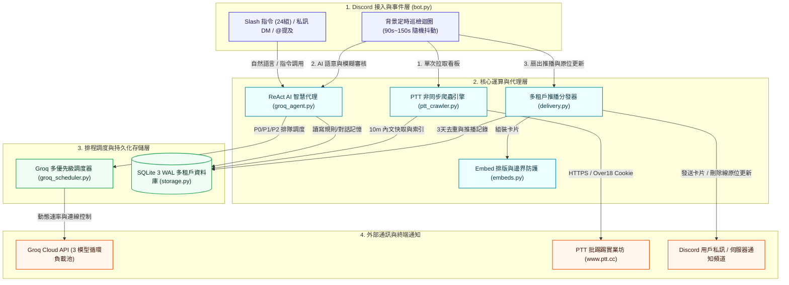
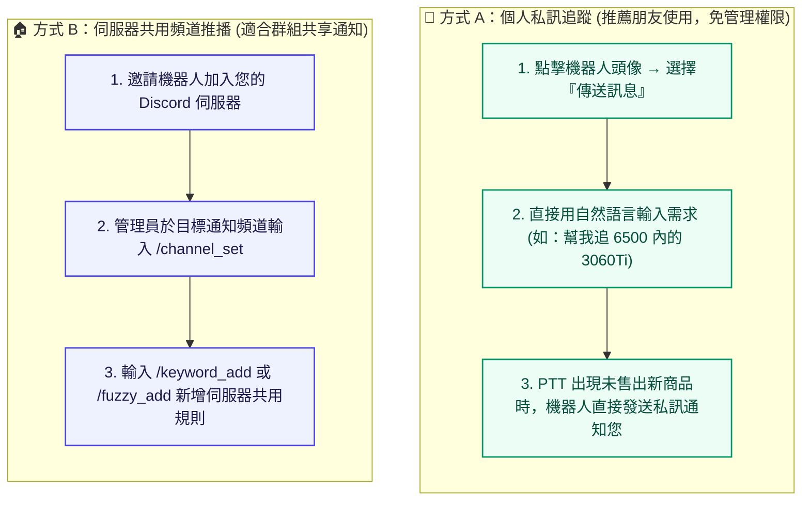

# PTT-DC-Bot：次世代 PTT 智慧監控與 AI 語意推播 Discord 機器人

<div align="center">

[English Version](README_EN.md) | **繁體中文版**

[](https://www.python.org/)
[](https://discordpy.readthedocs.io/)
[](https://groq.com/)
[](https://www.sqlite.org/wal.html)
[](#4-系統架構與單次爬取扇出流水線)
[](#5-八大維度深度安全加固矩陣)
[](#11-自動化測試驗證)
[](LICENSE)

**專為二手硬體買賣搶購與資訊盯梢打造・徹底告別已售出撲空、過時訊息洗版與 API 限流中斷**

</div>

---

## 目錄

- [1. 專案簡介與特色亮點](#1-專案簡介與特色亮點)
- [2. 痛點剖析與市面競品深度橫向對比（13 大評估維度）](#2-痛點剖析與市面競品深度橫向對比13-大評估維度)
- [3. 五大核心獨特優勢（Unique Selling Propositions - USPs）](#3-五大核心獨特優勢unique-selling-propositions---usps)
  - [3.1 USP 1：多租戶隔離架構與 SQLite WAL 零停機遷移](#31-usp-1多租戶隔離架構與-sqlite-wal-零停機遷移)
  - [3.2 USP 2：Groq 多模型優先級調度器（24,000 TPM 免費負載池）](#32-usp-2groq-多模型優先級調度器24000-tpm-免費負載池)
  - [3.3 USP 3：ReAct AI 自然語言代理與多層資安防禦矩陣](#33-usp-3react-ai-自然語言代理與多層資安防禦矩陣)
  - [3.4 USP 4：雙層已售出精準判定與 Discord 原位即時卡片更新](#34-usp-4雙層已售出精準判定與-discord-原位即時卡片更新)
  - [3.5 USP 5：多品項合售文獨立視角解析與價格消歧義引擎](#35-usp-5多品項合售文獨立視角解析與價格消歧義引擎)
- [4. 系統架構與單次爬取扇出流水線](#4-系統架構與單次爬取扇出流水線)
  - [4.1 四層系統解耦架構圖](#41-四層系統解耦架構圖)
  - [4.2 背景巡檢流水線（Crawl-Once, Fan-Out Pipeline）](#42-背景巡檢流水線crawl-once-fan-out-pipeline)
- [5. 八大維度深度安全加固矩陣](#5-八大維度深度安全加固矩陣)
- [6. 使用者操作指南](#6-使用者操作指南)
  - [6.1 個人私訊（DM）vs 伺服器頻道推播](#61-個人私訊dm-vs-伺服器頻道推播)
  - [6.2 自然語言 AI 智慧助手互動範例](#62-自然語言-ai-智慧助手互動範例)
  - [6.3 精確關鍵字規則語法](#63-精確關鍵字規則語法)
  - [6.4 AI 模糊語意規則設定](#64-ai-模糊語意規則設定)
  - [6.5 歷史未售出商品掃描（`/scan_unsold`）](#65-歷史未售出商品掃描scan_unsold)
- [7. 完整 Slash 指令規格表（24 組全功能指令）](#7-完整-slash-指令規格表24-組全功能指令)
- [8. 租戶階層與使用配額系統](#8-租戶階層與使用配額系統)
- [9. 系統部署指南](#9-系統部署指南)
  - [9.1 Docker Compose 一鍵部署（推薦）](#91-docker-compose-一鍵部署推薦)
  - [9.2 Linux systemd 原生服務常駐](#92-linux-systemd-原生服務常駐)
  - [9.3 本機虛擬環境與 tmux 常駐維運](#93-本機虛擬環境與-tmux-常駐維運)
  - [9.4 環境變數設定說明（`.env.example`）](#94-環境變數設定說明envexample)
- [10. 常見問題與排錯指南（FAQ）](#10-常見問題與排錯指南faq)
- [11. 自動化測試驗證](#11-自動化測試驗證)
- [12. 開源授權條款](#12-開源授權條款)

---

## 1. 專案簡介與特色亮點

**PTT-DC-Bot** 是一套專為批踢踢實業坊（PTT）設計之次世代非同步智慧監控與推播 Discord 機器人。專案深度結合 Python 高並發非同步生態（`asyncio` + `discord.py` + `aiohttp`）、Groq 雲端極速 LPU 推理 API、以及輕量級嵌入式 SQLite 3 WAL 多租戶隔離儲存。

本機器人專門鎖定 PTT 二手硬體交易看板（如 `HardwareSale` 電蝦二手、`MacShop` 蘋果二手、`Gamesale` 遊戲交易、`nb-shopping` 筆電交易等）以及各類資訊看板，具備以下五大跨世代突破：

1. **零頻道騷擾的原位更新**：推播卡片發出後，持續 18 小時追蹤賣家是否成交；一旦賣家補充售出，機器人自動呼叫 Discord API 進行**就地編輯加註刪除線**，徹底避免頻道充斥失效垃圾貼文。
2. **多品項合售文獨立視角**：同一篇貼文販售多樣商品（如 1060 售出、3060Ti 販售中），自動為每位訂閱者構建虛擬獨立切片視角，杜絕「一物售出、全篇誤殺」。
3. **Groq 優先級調度器**：透過自研三模型動態輪替池（累計高達 24,000 TPM），配合 P0~P3 搶佔式優先級佇列，讓你在完全零運營成本的前提下享受即時 AI 自然語言服務。
4. **極致爬蟲效率（Crawl-Once Fan-Out）**：全系統每輪巡檢對單一看板僅抓取一次，內文快取與 AI 推理結果全域跨租戶共享，徹底防止觸發 PTT 503 阻擋。
5. **軍事級 8 維度安全加固**：全面防禦 Prompt Injection 越獄逃逸、SSRF/路徑穿越、跨租戶越權修改，兼顧企業級安全與開放社群體驗。

---

## 2. 痛點剖析與市面競品深度橫向對比（13 大評估維度）

在 PTT 監控生態中，社群常見之方案包括歷史悠久的 **PttAlertor**、個人撰寫的 **傳統 Python Webhook 爬蟲腳本**、以及通用型 **RSS 訂閱機器人**。然而，面對現代 Discord 使用習慣與複雜的二手交易情境，傳統方案均暴露了嚴峻的技術局限性。

以下為 PTT-DC-Bot 與市面三大主流解決方案之 **13 大維度全方位橫向技術對比矩陣**：

| # | 評估維度 | 市面傳統 Webhook 腳本 | PttAlertor (Go/Redis) | RSS 訂閱機器人 (MonitoRSS) | **本專案 (PTT-DC-Bot)** |
| :-: | :--- | :--- | :--- | :--- | :--- |
| **1** | **推播通訊協定** | Discord Webhook (單向拋送) | LINE / Telegram / Messenger | Discord 訊息 (Bot Webhook) | **✅ Discord Native Client (Slash 指令 + 互動按鈕 View + 私訊/頻道)** |
| **2** | **多租戶隔離架構** | ❌ 無 (單一環境變數寫死) | ⚠️ 基礎 User ID 鍵值區分 | ❌ 無 (僅以 Discord 頻道劃分) | **✅ 完整多租戶 (SQLite WAL 獨立規則樹、私訊 vs 伺服器列級隔離、GDPR 級聯刪除)** |
| **3** | **伺服器權限管理 (RBAC)**| ❌ 無 | ❌ 無 (主要為個人帳號服務) | ⚠️ 依賴 Discord 頻道讀寫權限 | **✅ 嚴格 RBAC (管理員/擁有者方可變更公用規則，一般成員自動隔離引導至私訊)** |
| **4** | **爬蟲架構效率** | ❌ 線性 N 次重複爬取 (極易被封) | ⚠️ 集中爬取 | ❌ 取決於 RSS 生成器快取延遲 | **✅ Crawl-Once Fan-Out (單看板每輪僅爬一次，全租戶共享快取，基準線防爆保護)** |
| **5** | **已售出判讀深度** | ❌ 僅比對標題「售出」二字 | ❌ 僅比對標題或無 | ❌ 無 (無法判讀售出) | **✅ 雙層漏斗 (標題正則 + 簽名檔穿透作者最新推文 + Groq LLM 深度語意複審)** |
| **6** | **過時訊息與洗版抑制** | ❌ 永久殘留過時訊息，點入撲空 | ❌ 訊息發出後即永久脫鉤 | ❌ 訊息發出後即永久脫鉤 | **✅ 18h 原位動態編輯 (In-place Update，加註刪除線與原因，零多餘訊息騷擾)** |
| **7** | **多品項合售文解析** | ❌ 全篇單一判斷 (易連帶誤殺) | ❌ 全篇單一判斷 | ❌ 無品項分離能力 | **✅ 獨立虛擬視角 (Virtual Token View，個別品項獨立狀態、獨立標價與獨立推播)** |
| **8** | **價格消歧義引擎** | ❌ 粗糙正則 (常將型號當售價) | ❌ 無價格過濾功能 | ❌ 無價格提取能力 | **✅ 多層消除引擎 (遮蔽 3060/12G/750W 型號規格，支援 5.8k 換算、冒號與幣值錨定)** |
| **9** | **AI 自然語言互動** | ❌ 無 | ❌ 無 (僅傳統文字指令) | ❌ 無 | **✅ ReAct AI 智慧代理 (自然語言對話、自動尋板、模糊規則、Discord 排版轉譯)** |
| **10**| **LLM 負載與成本控制** | ❌ 無 | ❌ 無 | ❌ 無 | **✅ GroqScheduler (P0~P3 佇列、3 模型 24k TPM 循環負載池、動態 429 防抖動)** |
| **11**| **Prompt Injection 防護**| ❌ 無 | ❌ 無 | ❌ 無 | **✅ 深度防禦矩陣 (<untrusted_ptt_content> 邊界、意圖鎖定、標籤轉義防逃逸)** |
| **12**| **歷史未售出主動搜尋** | ❌ 無 | ❌ 無 | ❌ 無 | **✅ `/scan_unsold` 深度掃描 (回溯近期貼文、穿透推文與語意雙重校驗、防搶翻頁 View)** |
| **13**| **營運維護成本** | 免費 (自架但維護不易) | ⚠️ LINE Messaging API 收費昂貴 | 免費 (仰賴第三方 RSS 伺服器) | **✅ 100% 零成本 (Groq 免費層多模型池 + 本地 SQLite WAL + Docker 容器)** |

---

## 3. 五大核心獨特優勢（Unique Selling Propositions - USPs）

### 3.1 USP 1：多租戶隔離架構與 SQLite WAL 零停機遷移

- **多租戶資料模型**：
  系統底層以 `subscribers` 表為核心，明確區分 `scope = 'user'`（個人私訊訂閱者）與 `scope = 'guild'`（伺服器共用訂閱者）。所有關鍵字（`keywords`）、模糊規則（`fuzzy_rules`）、推播紀錄（`deliveries`）、對話記憶（`conversation_memory`）與配額計數器均綁定 `subscriber_id` 外鍵並啟用 `ON DELETE CASCADE`。
- **極致隱私保護與權限隔離**：
  朋友私訊機器人所設定之預算上限、關鍵字、AI 對話歷史，伺服器管理員或其他成員完全無權窺探；提供 `/forget_me` 一鍵徹底抹除個人於資料庫中的所有足跡，完全符合隱私權合規標準。
- **SQLite 3 WAL 高並發與自動遷移**：
  全面啟用 `PRAGMA journal_mode=WAL;` 與 `PRAGMA synchronous=NORMAL;`，讀寫分離互不阻塞。開機時自動執行版本偵測（Schema v1 ➜ v2 ➜ v3），自動建立唯讀 `.bak` 快照並以交易平滑升級，確保代碼演進不遺失任何歷史資料。

### 3.2 USP 2：Groq 多模型優先級調度器（24,000 TPM 免費負載池）

- **三模型循環負載池（24,000 TPM / 3,000 RPD）**：
  Groq 免費方案單一模型限制為 8,000 TPM / 1,000 RPD，背景持續輪詢極易引發 HTTP 429 速率限制阻斷。本系統自研 `GroqScheduler` 同時維護 3 個獨立模型桶：
  1. `openai/gpt-oss-120b`（主力深度語意推理）
  2. `qwen/qwen3.8-27b`（極速高吞吐多語言推理）
  3. `openai/gpt-oss-20b`（極速初篩與輔助推理）
  整體可用頻寬動態擴增至 **3 倍（24,000 TPM / 3,000 RPD）**，且完全合法免費。
- **四級搶佔式優先佇列（Priority Queue P0~P3）**：
  - **P0 (Interactive)**：使用者私訊對話、`/ai` 自然語言指令（秒級優先插隊處理）。
  - **P1 (Realtime)**：背景輪詢新文章之即時語意與 AI 模糊審核。
  - **P2 (Batch Scan)**：`/scan_unsold` 批次歷史掃描任務（自動讓位給 P0/P1，保留餘量）。
  - **P3 (Maintenance)**：系統定期維護與摘要任務。
- **Header-Driven 動態退避與並行槽位鎖**：
  排程器即時剖析 API 回傳標頭 `x-ratelimit-remaining-tokens` 與 `retry-after`。遇模型短暫飽和立即動態轉發至空閒模型；透過單一使用者任務鎖（`acquire_user_slot`），杜絕惡意連續點擊造成的資源耗盡。

### 3.3 USP 3：ReAct AI 自然語言代理與多層資安防禦矩陣

- **ReAct 遞迴工具調用引擎**：
  `GroqAgent` 具備自省與自主推理決策能力，內建 11 組原生 Function Calling 工具（支援 `find_ptt_boards`、`verify_and_add_board`、`add_exact_keyword`、`add_fuzzy_rule`、`scan_unsold_articles`、`read_article_detail` 等），支援最大 8 輪自省遞迴，能理解「幫我找看二手蘋果電腦該盯哪個板，並幫我追蹤 25000 內的 M2 MacBook Air」等複雜複合需求。
- **全方位提示詞注入防禦（Prompt Injection Defense）**：
  - **外部不可信邊界**：所有來自 PTT 網頁的爬取內容一律經由 `escape_prompt_xml` 嚴格跳脫後包裹於 `<untrusted_ptt_content>` 標籤中。
  - **狀態變更意圖校驗**：若代理人在處理外部文章後嘗試調用刪除或寫入工具，系統會在工具執行層直接檢驗使用者原始 Prompt 是否具備明確意圖；若外部文章誘使 AI 執行越權操作，系統實體攔截執行！
  - **RBAC 實體權限門禁**：工具執行器於底層檢查呼叫端 `can_write` 旗標，未獲授權成員即使透過 Prompt 誘導 AI 亦無法修改伺服器共用設定。
- **Discord 排版動態轉譯器**：
  Discord 聊天室原生不支援 Markdown 表格（`| 欄位 |`）。代理人內建排版轉譯引擎，能將 AI 產生的 Markdown 表格自動轉換為精美、結構清晰的條列式卡片（`• **商品**：...`），剔除不支持的 HTML 標籤。

### 3.4 USP 4：雙層已售出精準判定與 Discord 原位即時卡片更新

- **雙層漏斗過濾架構**：
  - **第一層（零 Token 特徵萃取）**：精準解析標題開頭、括號與結尾標註；特別是穿透解析 PTT 發信簽名檔（`※ 發信站`）下方作者本人的最新推文（如 `→ author: 已洽談，請勿再來信`）。同時建立安全白名單，避免「誠意售出」、「價格暫定」造成誤判。
  - **第二層（AI 深度語意複審）**：將內文、作者補充與買家排隊推文組合，由 Groq LLM 判讀買家是否已無機會購買。
- **Discord 原位即時更新（In-place Embed Update）**：
  - 傳統機器人推播後便不再維護，頻道充斥早已賣掉的無效商品。
  - 本系統將 `message_id` 與推播記錄持久化於 SQLite，背景 Fair Round-Robin 定期重新檢查 18 小時內的推播貼文。
  - 一旦賣家標註售出，機器人自動呼叫 Discord API 就地編輯原始卡片（標題加上刪除線 `🔴【已售出/已結案】~~原標題~~`、顏色轉為灰色、附加售出原因說明），**完全不發送多餘訊息騷擾頻道**！

### 3.5 USP 5：多品項合售文獨立視角解析與價格消歧義引擎

- **多品項獨立虛擬視角（Token View）**：
  面對同一篇貼文合售「1. 1060 (售出) 2. 3060Ti (販售中)」之情況，傳統爬蟲會因「售出」二字將整篇貼文拋棄，導致追蹤 3060Ti 的買家錯失良機。本系統實作 `apply_keyword_view`，根據每位訂閱者關注的品項動態建立獨立虛擬視角。1 號商品的售出狀態僅作用於 1 號品項，關注 2 號商品的買家仍能即時收到通知，且售價精確綁定 2 號商品標價。
- **型號與價格消歧義正則引擎**：
  內建硬體型號遮蔽前置處理（過濾 RTX/GTX/RX/i5/DDR5/12G/750W 等規格字眼），杜絕將 `RTX 3060` 抓成 3060 元的常見笑話。支援 `5.8k` / `6k` 自動乘以 1000 換算，並優先識別冒號、貨幣符號前後之數值。

---

## 4. 系統架構與單次爬取扇出流水線

### 4.1 四層系統解耦架構圖



### 4.2 背景巡檢流水線（Crawl-Once, Fan-Out Pipeline）


1. **聚合活躍看板**：僅針對全系統「啟用中訂閱者」有綁定規則之看板發起巡檢，無規則看板自動休眠跳過。
2. **單次爬取與未讀過濾**：每個看板每輪僅發送一次 HTTP 請求，透過 `seen_articles` 索引表過濾出全新文章。
3. **規則初篩與多品項切片**：比對所有訂閱者的關鍵字（含 `-排除字` 與數字邊界保護），抓出基礎內文並依各關鍵字切出獨立品項視角（`apply_keyword_view`）。
4. **Groq 多模型語意確認**：販售文交由 `GroqScheduler` 排入 `P1` 佇列，確認目標品項尚未售出並提取專屬標價與保固摘要。
5. **多租戶去重與扇出推播**：通過 3 天重發雜湊（`dedupe_hash`）檢查後，依訂閱者設定分發至個人私訊（DM）或伺服器通知頻道。
6. **18h 售出狀態原位更新**：背景定期巡檢過去 18 小時內已推播之文章；若賣家後續改標售出，立即原位編輯 Discord 卡片加上刪除線。

---

## 5. 八大維度深度安全加固矩陣

專案依據開源高標準與紅藍對抗審計規範，落實 **8 大安全防禦柱石**：

| 維度 | 防禦範圍與潛在風險 | 本系統代碼級加固實作 |
| :--- | :--- | :--- |
| **1. Prompt Injection 防護** | 惡意文章嵌入指令誘導 AI 刪除規則、篡改預算或逃逸標籤限制。 | 1. 外部 PTT 內容經 `escape_prompt_xml` 跳脫後以 `<untrusted_ptt_content>` 包覆。<br>2. 實施嚴格**意圖鎖定機制**：若原始使用者指令無變更意圖，外部文章誘發之寫入/刪除工具執行一律被實體攔截。<br>3. 模糊規則描述以獨立 Nonce 標籤隔離，防止跨規則逃逸。 |
| **2. SQL Injection 與 SSRF 防護** | 惡意看板名稱、偽造網址誘使爬蟲探測內網（如 AWS Metadata `169.254.169.254`）或 SQL 注入。 | 1. 所有 SQLite 查詢 100% 採用參數化佔位符 `?`，模糊查詢使用 `ESCAPE '/'` 轉義 `%` 與 `_`。<br>2. 正則白名單限制 `https://www.ptt.cc/bbs/`，HTTP Client 停用自動重定向（`allow_redirects=False`），徹底杜絕 301/302 SSRF 跳轉。 |
| **3. 多租戶 RBAC 權限與資料隔離** | 普通伺服器成員篡改伺服器規則、跨伺服器頻道綁定或越權窺探他方資料。 | 1. 列級實體隔離 `scope='user'` 與 `scope='guild'`。<br>2. 嚴格 RBAC 門禁：非管理員僅能變更個人私訊規則；工具執行層校驗 `can_write` 旗標。<br>3. 跨伺服器頻道指派防禦：強制驗證目標文字頻道必須屬於當前互動之 Guild。 |
| **4. 輸入消毒與驗證** | 使用者傳入極限字串、惡意 `@everyone` 洗版或畸形 Markdown 破壞渲染。 | 1. 前置消毒清理 `@everyone`、`<@!id>`、`<#channel>` 與自訂表情符號。<br>2. 限制關鍵字 $\le 50$ 字元、模糊描述 $\le 200$ 字元；分類白名單限制為 `賣/徵/換/情報/ALL`。<br>3. `enforce_embed_limits` 實施 5,800 字元防爆截斷，杜絕 Discord API 400 錯誤。 |
| **5. Rate Limit 與 DoS 韌性** | 連續高頻呼叫 `/scan_unsold` 或 `/search` 導致爬蟲阻塞、LLM 佇列耗盡或伺服器卡死。 | 1. 自研 `GroqScheduler` 動態解析限流標頭，三模型 24k TPM 循環調度。<br>2. 實作單一使用者任務鎖（`acquire_user_slot`），限制每人同一時間僅能執行一個 AI 任務與搜尋任務，`/search` 具備 10 秒防刷冷卻。<br>3. 優先級佇列設定安全長度上限，滿載時優雅降級回覆。 |
| **6. Race Conditions 與並行控制** | 多協程同時寫入資料庫、WAL Checkpoint 鎖死、線上備份資料損壞。 | 1. SQLite WAL 模式搭配 `threading.RLock()` 與 `busy_timeout=5000` 毫秒防死鎖。<br>2. 每日自動維護改採 SQLite 官方標準原子備份 API `conn.backup()`，100% 確保線上備份快照一致性。<br>3. 推播去重依賴 3 天 SHA1 雜湊與唯一外鍵約束，防止並發重複推播。 |
| **7. 憑證與敏感資訊外洩防範** | 例外 Traceback 洩漏伺服器路徑、日誌洩漏 API Key、Token 遺留程式碼。 | 1. Discord 前端回傳全面通用化脫敏（如「處理時發生系統錯誤」），詳細堆疊僅留存內部日誌。<br>2. 啟動入口主動設定 `os.umask(0o077)`，確保資料庫與日誌僅擁有者可讀寫。<br>3. 專案零憑證硬編碼，所有金鑰嚴格透過環境變數注入。 |
| **8. Docker 容器權限與部署安全** | 容器內以 root 執行、程式碼可被竄改植入後門、缺乏資源上限配額。 | 1. Dockerfile 建立非 root 專用帳號 `botuser (UID 1000)`，程式碼目錄設為 `root:root (0755)` 唯讀，僅 `/app/data` 可寫。<br>2. Docker Compose 啟用 `no-new-privileges:true`、`cap_drop: [ALL]`，限制記憶體 512MB 與 1.0 CPU，配置自動健康檢查探針。 |

---

## 6. 使用者操作指南

### 6.1 個人私訊（DM）vs 伺服器頻道推播



> [!TIP]
> **私訊使用小提醒**：請確認 Discord「使用者設定 > 隱私與安全」中，已開啟共同伺服器的「允許來自伺服器成員的私人訊息」。若曾發生推播失敗，只需主動傳送任意訊息給機器人即可自動解除暫停狀態！

### 6.2 自然語言 AI 智慧助手互動範例

您可以直接在私訊中傳送訊息，或在頻道使用 `/ai` 指令，AI 會自主解析語意並調用相應工具：

- **新增型號與預算追蹤**：
  > 「幫我追蹤 HardwareSale 板販售的 4070S，預算 18000 元以內」
- **複合條件模糊追蹤**：
  > 「我想追蹤台北面交、原廠保固還有一年以上、非礦卡的 3060Ti，預算 6500」
- **智慧看板尋找與追蹤**：
  > 「我想買二手筆電或 MacBook，幫我找合適的 PTT 看板並加入監控清單」
- **掃描過去未售出商品**：
  > 「幫我掃描目前 HardwareSale 板上還沒賣掉的 6700XT」
- **查詢現有設定**：
  > 「列出我目前設定的所有關鍵字與規則」

### 6.3 精確關鍵字規則語法

使用 `/keyword_add` 可建立不消耗每日 AI 對話額度的極速比對條件：

- **空白組合（代表 AND）**：`台北 3060TI`（標題須同時具備「台北」與「3060TI」）
- **排除詞（以 `-` 開頭）**：`3060 -ti -筆電 -礦`（追蹤純 3060，排除 3060Ti、筆電與礦卡）
- **價格上限（`max_price`）**：設定為 `6500`，標題或內文價格超過 6500 元自動略過。

### 6.4 AI 模糊語意規則設定

使用 `/fuzzy_add` 設定複雜的語意追蹤：
- `description`：自然語言描述你想買的商品條件、保固狀態或特殊需求。
- `hint_keywords`（強烈建議填寫）：初篩關鍵字（如 `3060,3060ti`），命中初篩詞才啟動 LLM 審核，可大幅節省系統算力並加快推播速度。

### 6.5 歷史未售出商品掃描（`/scan_unsold`）

想主動尋找目前版面上「還沒賣掉」的二手硬體？
- 執行 `/scan_unsold keyword: 3060TI`
- 系統將自動回溯爬取近期文章，穿透簽名檔推文與 AI 語意審核，過濾掉所有已洽談、暫售與結案貼文，並以分頁卡片顯示所有確定可聯絡購買的商品清單與標價！

---

## 7. 完整 Slash 指令規格表（24 組全功能指令）

系統內建 24 組全域 Discord Slash 指令，依功能範疇劃分如下：

### 7.1 AI 智慧助手與即時搜尋

| 指令 | 參數規格 | 權限需求 | 功能說明 |
| :--- | :--- | :--- | :--- |
| `/ai` | `prompt` (必填), `scope` (auto/user/guild) | 全員可讀 / 寫入需 RBAC | 以自然語言指示 AI 助手尋找看板、設定規則或分析行情。 |
| `/scan_unsold` | `keyword` (選填), `board` (預設 HardwareSale), `max_per_keyword` (1~8), `push_to_channel` (布林), `scope` | 全員 (受每日配額管制) | 深度掃描歷史未售出貼文，多模型語意審核，支援分頁檢視。 |
| `/search` | `keyword` (必填), `board` (預設 HardwareSale), `pages` (1~2) | 全員 (不消耗配額) | 調用 PTT 原生搜尋引擎查詢文章列表（不過濾售出狀態）。 |

### 7.2 精確關鍵字管理（`/keyword_*`）

| 指令 | 參數規格 | 權限需求 | 功能說明 |
| :--- | :--- | :--- | :--- |
| `/keyword_add` | `keyword` (必填), `board` (預設 HardwareSale), `category` (預設賣), `max_price` (選填), `scope` | 個人 / 伺服器管理者 | 新增精確關鍵字（支援空白 AND、`-` 排除詞與預算上限）。 |
| `/keyword_edit` | `keyword_id` (自動補齊), `new_keyword` (選填), `max_price` (選填, 0為清除), `scope` | 個人 / 伺服器管理者 | 編輯現有精確關鍵字內容或預算上限。 |
| `/keyword_remove`| `keyword` (自動補齊), `scope` | 個人 / 伺服器管理者 | 依編號或名稱移除指定的精確關鍵字。 |
| `/keyword_list` | `scope` (選填) | 全員 (唯讀) | 查看當前範圍已啟用的所有關鍵字、模糊規則與推播狀態。 |
| `/keyword_clear`| `scope` (選填) | 個人 / 伺服器管理者 | 一鍵清空當前範圍內的所有精確關鍵字。 |

### 7.3 AI 模糊語意規則管理（`/fuzzy_*`）

| 指令 | 參數規格 | 權限需求 | 功能說明 |
| :--- | :--- | :--- | :--- |
| `/fuzzy_add` | `description` (必填), `board` (預設 HardwareSale), `category` (預設賣), `hint_keywords` (選填), `scope` | 個人 / 伺服器管理者 | 新增自然語言 AI 模糊追蹤條件。 |
| `/fuzzy_remove` | `rule` (自動補齊), `scope` | 個人 / 伺服器管理者 | 依編號或內容片段移除指定的 AI 模糊規則。 |
| `/fuzzy_list` | `scope` (選填) | 全員 (唯讀) | 查看當前範圍已啟用的所有 AI 模糊追蹤規則。 |

### 7.4 看板監控管理（`/board_*`）

| 指令 | 參數規格 | 權限需求 | 功能說明 |
| :--- | :--- | :--- | :--- |
| `/board_add` | `board` (必填), `scope` | 個人 / 伺服器管理者 | 驗證指定 PTT 看板並加入背景盯梢清單，執行基準線靜默同步。 |
| `/board_remove` | `board` (自動補齊), `scope` | 個人 / 伺服器管理者 | 移除在該看板的規則；若全系統無人使用則自動停止巡檢。 |
| `/board_list` | 無 | 全員 (唯讀) | 檢視系統目前正在巡檢的所有 PTT 看板與索引狀態。 |

### 7.5 推播通道與個人帳戶管理

| 指令 | 參數規格 | 權限需求 | 功能說明 |
| :--- | :--- | :--- | :--- |
| `/channel_set` | `channel` (選填), `scope` | 個人 / 伺服器管理者 | 設定推播文字頻道（私訊不填則設為私訊通知）。 |
| `/push_mode` | `mode` (`keyword`/`all`), `scope` | 僅限 owner 管理員 | 切換推播模式（精準匹配 vs 全量新文推播）。 |
| `/pause` | `scope` (選填) | 個人 / 伺服器管理者 | 暫停當前範圍的自動推播通知（完整保留所有規則）。 |
| `/resume` | `scope` (選填) | 個人 / 伺服器管理者 | 恢復當前範圍的自動推播通知。 |
| `/me` | 無 | 全員 (私密回覆) | 查看呼叫者個人的追蹤規則、私訊狀態與今日剩餘配額。 |
| `/forget_me` | 無 | 全員 (私密回覆) | GDPR 隱私清除：一鍵徹底刪除個人所有規則、推播紀錄與對話記憶。 |
| `/status` | `scope` (選填) | 全員 (唯讀) | 檢視系統運行指標、Groq 佇列負載與防封鎖冷卻狀態。 |
| `/check_now` | 無 | 全員 (非管理員冷卻 5m) | 手動觸發一次全系統看板巡檢。 |
| `/admin` | `action` (stats/set_tier/blacklist/unblacklist), `target_id`, `tier` | 系統擁有者專用 | 管理員面板：查看租戶統計、調整配額等級、管理黑名單。 |
| `/help` | 無 | 全員 | 顯示完整使用指南、私訊操作範例與進階語法。 |

---

## 8. 租戶階層與使用配額系統

系統實施階層化租戶配額管理，確保公共資源平穩分配：

| 配額維度 | 個人私訊使用者 (`friend`) | 一般外部伺服器 (`free`) | 系統管理員 / 主伺服器 (`owner`) |
| :--- | :---: | :---: | :---: |
| **精確關鍵字數量上限** | 30 組 | 10 組 | 999 組 |
| **AI 模糊規則數量上限** | 8 組 | 3 組 | 999 組 |
| **同時追蹤不同看板數** | 5 個 | 5 個 | 20 個（全系統安全上限 25） |
| **每日主動 AI 對話次數 (`/ai` / 私訊)** | 60 次 / 日 | 20 次 / 日 | 無限制 |
| **每日歷史未售出掃描 (`/scan_unsold`)** | 25 次 / 日 | 8 次 / 日 | 無限制 |
| **單一使用者並行任務鎖** | AI 1 個 + 掃描 1 個 | AI 1 個 + 掃描 1 個 | AI 1 個 + 掃描 1 個 |
| **單輪單訂閱者推播上限** | 5 則（其餘摺疊為摘要卡） | 5 則（其餘摺疊為摘要卡） | 5 則（其餘摺疊為摘要卡） |

> [!NOTE]
> 背景巡檢時自動觸發之關鍵字命中確認與模糊比對屬於**系統背景共用佇列**，**完全不消耗**使用者的「每日 AI 對話」或「歷史掃描」配額！

---

## 9. 系統部署指南

### 9.1 Docker Compose 一鍵部署（推薦）

專案包含生產級 `Dockerfile` 與 `docker-compose.yml`，已預設非 root 帳號與安全權限：

```bash
# 1. 複製並設定環境變數
cp .env.example .env
chmod 600 .env
nano .env  # 填入 DISCORD_TOKEN 與 GROQ_API_KEY

# 2. 建立資料庫持久化掛載目錄
mkdir -p data

# 3. 構建並啟動容器常駐服務
docker compose up -d --build

# 4. 查看即時運行日誌
docker compose logs -f

# 5. 停止服務
docker compose down
```

### 9.2 Linux systemd 原生服務常駐

若部署在 Linux 主機原生環境，可使用專案內建之 systemd 設定範本：

```bash
# 1. 編輯服務檔案中的路徑與使用者
sudo cp ptt-bot.service /etc/systemd/system/ptt-bot.service
sudo nano /etc/systemd/system/ptt-bot.service

# 2. 重新載入守護程序並開機自動啟動
sudo systemctl daemon-reload
sudo systemctl enable --now ptt-bot

# 3. 檢查運行狀態與日誌
sudo systemctl status ptt-bot
journalctl -u ptt-bot -f
```

### 9.3 本機虛擬環境與 tmux 常駐維運

```bash
# 1. 建立獨立虛擬環境並安裝依賴
python3 -m venv venv
source venv/bin/activate
pip install -r requirements.txt

# 2. 啟動 tmux 背景常駐服務（支援異常重啟與循環日誌保護）
bash restart_bg.sh

# 3. 查看即時日誌
tail -f bot.log

# 4. 停止 tmux 背景服務
bash stop_bg.sh
```

### 9.4 環境變數設定說明（`.env.example`）

```ini
# Discord 應用程式機器人 Token (必填)
DISCORD_TOKEN=your_discord_bot_token_here

# 預設推播目標（選填，亦可部署後於頻道內執行 /channel_set 設定）
DEFAULT_CHANNEL_ID=123456789012345678
DEFAULT_GUILD_ID=987654321098765432
OWNER_USER_ID=

# 預設盯梢看板與輪詢隨機抖動間隔（秒）
DEFAULT_BOARD=HardwareSale
POLL_INTERVAL_MIN=90
POLL_INTERVAL_MAX=150

# Groq Cloud API 配置 (AI 語意必填)
GROQ_API_KEY=gsk_your_groq_api_key_here
GROQ_MODEL=openai/gpt-oss-120b
GROQ_FAST_MODEL=openai/gpt-oss-20b

# 資料庫與日誌路徑 (容器環境設為 /app/data/...)
DB_PATH=bot_data.db
LOG_PATH=bot.log
LOG_TO_STDOUT=1
```

---

## 10. 常見問題與排錯指南（FAQ）

### Q1：在私訊設定了追蹤，但符合條件的新文章發布時沒有收到通知？
1. 請先執行 `/me` 查看個人狀態：
   - 若狀態顯示為「暫停推播」，請執行 `/resume` 恢復通知。
   - 若狀態顯示為「曾發生私訊失敗」，代表您的 Discord 隱私設定封鎖了機器人訊息。請至 Discord「使用者設定 > 隱私與安全」開啟共同伺服器的「允許來自伺服器成員的私人訊息」，接著**主動傳送一則私訊給機器人**，系統即會自動重設狀態恢復推播。

### Q2：為什麼符合關鍵字的文章沒有被推播或出現在 `/scan_unsold` 結果中？
系統具有嚴格的雙重過濾機制，以下情況會自動排除：
1. 文章發布時間已超過 21 天。
2. 標題或簽名檔下方作者推文包含「已售、售出、暫售、已洽談、洽中、已預定、不用再來信、信箱爆了、感謝PTT」等結案詞。
3. 相同賣家在 3 天內重複張貼相同品項之文章（3 天去重機制）。
4. 設定了 `max_price` 預算上限，且文章中目標商品的標價高於該預算。
若您希望查詢包含已售出的歷史完整貼文，請改用 `/search` 指令。

### Q3：在別人伺服器頻道中輸入指令顯示「權限不足」？
在伺服器文字頻道中執行指令預設會操作「該伺服器的公用追蹤規則」，需具備該伺服器的管理權限。若您想管理個人的追蹤條件，請：
- 直接**私訊（DM）機器人**下達指令（最推薦）。
- 或在使用 Slash 指令時，將 `scope` 參數指定為 `👤 個人專屬追蹤`。

---

## 11. 自動化測試驗證

本專案堅持代碼品質與真實可驗證性，所有測試均基於本地合成資料與 Ephemeral SQLite WAL 資料庫，執行完畢 100% 零殘留（Zero-Trash）：

```bash
# 執行單元與安全性整合測試套件
python3 -m unittest discover -s tests -p "test_*.py" -v
```

測試驗證範圍涵蓋：
- SQLite WAL 資料庫 Schema 升級遷移（v1 ➜ v2 ➜ v3）與外鍵級聯防護
- 多租戶個人私訊與伺服器共用規則嚴格列級隔離
- PTT 503 暫態錯誤基準線容錯保護（永不發送舊文洪水）
- 簽名檔作者推文穿透解析與售出白名單防誤判
- 多品項合售文獨立虛擬視角（`apply_keyword_view`）切片驗證
- 硬體型號遮蔽與價格正規化消歧義正則引擎
- Prompt Injection 惡意指令隔離防護與 RBAC 寫入門禁
- SSRF 與非法看板路徑穿越攔截

---

## 12. 開源授權條款

本專案採用 [MIT License](LICENSE) 授權開源發布。歡迎全球開源社群提交 Pull Request 或開立 Issue 共同參與交流！
