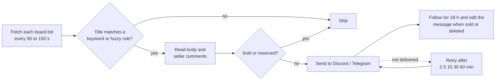

# PTT-DC-Bot

**English** | [繁體中文](README.md)

[](https://github.com/jasonxp516/ptt-dc-bot/actions/workflows/ci.yml)
[](https://github.com/jasonxp516/ptt-dc-bot/releases/latest)
[](https://www.python.org/)
[](https://github.com/jasonxp516/ptt-dc-bot/pkgs/container/ptt-dc-bot)
[](LICENSE)

A bot that watches second-hand trading boards on PTT (Taiwan's largest bulletin board system) and alerts you when a new post matches your conditions and the item is still available. Alerts go to Discord or Telegram, and when the item sells the bot strikes through the alert it already sent.

<p align="center">
  
</p>

> Alert cards, the keyword form and most command replies are in Traditional Chinese, because PTT posts are. Setting `BOT_LANGUAGE=en` translates the `/setup` panel only.

**Contents**: [What it does](#what-it-does) · [Before you start](#before-you-start) · [Install](#install) · [Five-minute setup](#five-minute-setup) · [Keyword syntax](#keyword-syntax) · [Commands](#commands) · [Notification platforms](#notification-platforms) · [Configuration](#configuration) · [How it works](#how-it-works) · [Upgrade and backup](#upgrade-and-backup) · [Troubleshooting](#troubleshooting) · [Known limitations](#known-limitations)

---

## What it does

- **Alerts only for items you can still buy.** Before alerting, the bot reads the post body and the seller's own comments. Posts marked sold, reserved or "stop mailing me" are skipped.
- **Strikes through sold items.** Each alert is followed for 18 hours. When the item sells or the post is deleted, the original message is edited in place.
- **Understands multi-item posts.** When one post sells several things, only the item you track decides the sold state and the price.
- **Budget filter that is not fooled by model numbers.** Numbers such as `RTX 3060`, `12G` or `750W` are not read as prices, and `5.8k` becomes 5800.
- **Natural language.** With a Groq API key you can simply tell the bot "track a 3060 Ti under 6500 with warranty".
- **Shared server rules or personal DMs.** One bot serves many servers and users, each with separate rules.
- **Retries failed alerts.** If the channel is temporarily unavailable or the network drops, the alert is queued and sent later.

<p align="center">
  
</p>

## Before you start

| Item | Required | Where to get it |
| :--- | :--- | :--- |
| Discord bot token | Yes | Create an application in the [Discord Developer Portal](https://discord.com/developers/applications), then Reset Token on the Bot page |
| Runtime | Yes | Python 3.10 or later, or Docker |
| Groq API key | No | Free from the [Groq Console](https://console.groq.com/keys). Without it the bot still works, minus AI checks, fuzzy rules and `/ai` chat |

When inviting the bot:

- Scopes `bot` and `applications.commands`, permission integer `274877975552` (View Channels, Send Messages, Embed Links, Read Message History).
- **No** Privileged Gateway Intents are needed, and **no** Message Content Intent.

## Install

**Linux / macOS**

```bash
curl -fsSL https://raw.githubusercontent.com/jasonxp516/ptt-dc-bot/main/install.sh | bash
```

**Windows (PowerShell)**

```powershell
irm https://raw.githubusercontent.com/jasonxp516/ptt-dc-bot/main/install.ps1 | iex
```

The script creates a virtual environment, installs dependencies and starts a setup wizard that asks for your token. To inspect the script first, download it to a file and read it before running.

**Docker**

```bash
mkdir -p ptt-dc-bot/data && cd ptt-dc-bot
curl -fsSL https://raw.githubusercontent.com/jasonxp516/ptt-dc-bot/main/docker-compose.yml -o docker-compose.yml
curl -fsSL https://raw.githubusercontent.com/jasonxp516/ptt-dc-bot/main/.env.example -o .env
chmod 600 .env        # edit .env and set at least DISCORD_TOKEN
docker compose up -d
```

More deployment guides: [Docker in detail](docs/deploy-docker.md) · [Synology DSM](docs/deploy-synology.md) · [unRAID](docs/deploy-unraid.md) · [Linux systemd / tmux](docs/deploy-linux.md)

## Five-minute setup

The pictures are illustrations that use the bot's real interface text.

**1. Run `/setup` in the channel that should receive alerts** and press "Bind Channel". For personal alerts, DM the bot and run `/setup` there.

<p align="center">
  
</p>

**2. Pick the boards to watch from the dropdown.** Other boards can be added with `/board_add`.

<p align="center">
  
</p>

**3. Press "Add Keyword"** and fill in the keyword and an optional budget. The four fields are: keyword (required), target board, category (default 賣 = selling), and maximum price in NT$.

<p align="center">
  
</p>

**4. Press "Test Alert"** to confirm a card arrives. From then on matching new posts are sent automatically.

## Keyword syntax

| Input | Meaning |
| :--- | :--- |
| `3060` | Title contains 3060 |
| `3060 台北` | Contains both 3060 and 台北 (a space means AND) |
| `3060 -ti -筆電` | Contains 3060 but neither ti nor 筆電 |
| `4070 super` with max price `18000` | Contains 4070 and super, and the price is at most 18000 |

- Matching is done on the post title, case-insensitive. `3060Ti` and `3060 Ti` are treated the same.
- The default category is `賣` (selling). Others: `徵` (wanted), `換` (trade), `情報` (deals), or `ALL`.
- A post without a stated price is not blocked by the budget and is still sent.

**Keyword or AI fuzzy rule?** Use a keyword (`/keyword_add`) when you know the model: it is fast and uses no AI quota. Use a fuzzy rule (`/fuzzy_add`) when the condition is hard to express as keywords, for example "dual-fan card with warranty, pickup in Taipei". Fuzzy rules need a Groq API key.

## Commands

**Everyday use**

| Command | Description |
| :--- | :--- |
| `/setup` | Open the setup panel (start here) |
| `/keyword_add` `/keyword_edit` `/keyword_remove` | Add, edit or remove an exact keyword |
| `/keyword_list` `/keyword_clear` | List all rules, clear keywords |
| `/fuzzy_add` `/fuzzy_remove` `/fuzzy_list` | Manage AI fuzzy rules |
| `/board_add` `/board_remove` `/board_list` | Manage watched boards |
| `/channel_set` | Change the alert channel |
| `/push_mode` | Switch between "matching posts only" and "every new post" |
| `/pause` `/resume` | Pause or resume alerts (rules are kept) |
| `/ai` | Ask the AI assistant to set rules, find boards or scan listings |
| `/scan_unsold` | Scan recent posts for items that are still unsold |
| `/search` | Search a board with PTT's own search |
| `/check_now` | Run a check immediately |
| `/status` `/me` `/help` | Bot status, your settings and quota, usage guide |
| `/forget_me` | Permanently delete your rules, alert history and chat memory |

Most commands take a `scope` option: personal or server-wide. Changing server-wide rules requires Manage Server or Manage Channels. You can also DM the bot or @mention it and talk in natural language.

**Owner only**

| Command | Description |
| :--- | :--- |
| `/admin` | List subscribers, change quota tiers, manage the blacklist |
| `/email_copy` | Turn the Email copy on or off |

**Telegram**

`/start` · `/keyword_add` · `/keyword_list` · `/keyword_remove` · `/pause` · `/resume` · `/status` · `/me` · `/forget_me` · `/help`

```text
/keyword_add 3060Ti 7000                    board defaults to HardwareSale, category to 賣
/keyword_add MacShop 賣 macbook 30000       explicit board and category
```

## Notification platforms

**Discord** (required): server channels and personal DMs, with the full feature set.

**Telegram** (optional)

1. Get a token from [@BotFather](https://t.me/BotFather).
2. Set `ENABLE_TELEGRAM=true` and `TELEGRAM_BOT_TOKEN` in `.env`, then restart.
3. DM your Telegram bot or add it to a group and send `/start`.

No public IP or domain is needed. In groups only group administrators (or IDs in `TELEGRAM_ADMIN_USER_ID`) can change settings. Telegram currently supports exact keywords only: no fuzzy rules and no AI chat.

**Email** (optional, copy mode): every alert delivered on Discord or Telegram is also mailed to you.

1. Set `ENABLE_EMAIL=true`, `SMTP_HOST`, `SMTP_USER`, `SMTP_PASSWORD` and `EMAIL_TO` in `.env`, then restart. Gmail needs a 16-character app password.
2. As the owner, run `/email_copy` in Discord and choose on. The bot sends a test mail first and enables the copy only if it succeeds.

## Configuration

All settings live in `.env` in the project directory. Restart after changing them. The full template is [.env.example](.env.example).

| Setting | Default | Description |
| :--- | :--- | :--- |
| `DISCORD_TOKEN` | none (required) | Discord bot token |
| `OWNER_USER_ID` | auto-detected | Discord user ID of the owner, who may use `/admin` and `/email_copy` |
| `DEFAULT_GUILD_ID` `DEFAULT_CHANNEL_ID` | empty | Home server and default alert channel; `/setup` can set these instead |
| `GROQ_API_KEY` | empty | Leave empty to run without AI, on rules only |
| `GROQ_MODELS` | empty | Comma-separated model list; use it to replace a model Groq has retired |
| `POLL_INTERVAL_MIN` `POLL_INTERVAL_MAX` | `90` `150` | Range in seconds between checks, minimum 30 |
| `MAX_ARTICLE_AGE_HOURS` | `24` | Posts older than this are not sent; also the limit for catching up after downtime |
| `DEFAULT_BOARD` | `HardwareSale` | Default board |
| `BOT_LANGUAGE` | `zh_TW` | Language of the setup panel; `en` is available |
| `ENABLE_TELEGRAM` `TELEGRAM_BOT_TOKEN` | `false`, empty | Enable Telegram |
| `TELEGRAM_ADMIN_USER_ID` | empty | Telegram user IDs that may manage any group's rules |
| `TELEGRAM_BLOCKED_USER_IDS` | empty | Telegram user IDs the bot ignores completely |
| `ENABLE_EMAIL` `SMTP_*` `EMAIL_TO` | `false` | Mail settings and recipient for the Email copy |

Separate multiple IDs with commas.

## How it works



- Each board is fetched once per round no matter how many people use the bot, and post bodies are cached, so more users do not mean more load on PTT.
- When PTT rate-limits the bot it pauses and backs off, then resumes by itself.
- After downtime the bot catches up on at most 5 pages and 24 hours of posts.
- Sold detection uses rules first (title, body, seller comments) and an AI review when a Groq key is set. If the AI is unavailable the bot falls back to rules.

## Upgrade and backup

**Upgrade**

```bash
# Docker
docker compose pull && docker compose up -d

# One-line install (when it was downloaded with git): update, then restart the bot
cd ~/ptt-dc-bot && git pull && ./venv/bin/pip install -r requirements.txt
```

Without git, download the [latest release package](https://github.com/jasonxp516/ptt-dc-bot/releases/latest) and overwrite the program files, keeping `.env` and `bot_data.db`. The database upgrades itself on start. Changes per version are in [CHANGELOG.md](CHANGELOG.md) (Chinese).

**Data and backups**

- All data is in `bot_data.db` (`data/bot_data.db` with Docker).
- A backup is written daily to `backups/` next to it, keeping the latest 7.
- To restore: stop the bot, copy a backup back as `bot_data.db`, start the bot.

## Troubleshooting

| Symptom | What to do |
| :--- | :--- |
| Slash commands do not show up | New commands can take from a few minutes to an hour to reach Discord. Check the invite included `applications.commands` |
| No alerts | Run `/status` to see whether checks are running and whether alerts are paused. Check the bot may send messages and embed links in the channel. The keyword may be too strict |
| `/status` shows a board error or cooldown | PTT is rate-limiting; it recovers by itself. The owner is told after 5 failures in a row and again on recovery |
| AI does not answer, or the owner gets "Groq 模型設定需要更新" | Groq retired a model. Put working models in `GROQ_MODELS` and restart |
| Telegram does not respond | Check the log. A wrong token stops the connection. `409 Conflict` means two programs use the same token; stop one |
| Docker reports unhealthy | Make sure the container can write to `data/` (it runs as UID 1000) |
| Need details | The log is `bot.log` (Docker: `docker compose logs -f`) |

## Known limitations

- A Discord bot token is required to start. Telegram cannot run on its own yet.
- Telegram supports exact keywords only.
- Email is a copy only; a mail already sent cannot be updated when the item sells.
- A post published within about two minutes of creating a subscription may be sent twice or missed.
- Matching looks at titles only. A model mentioned only in the body needs an AI fuzzy rule.
- This project is not affiliated with PTT. Keep the default check interval so the bot does not burden PTT.

## Privacy

The bot stores subscriber IDs, tracking rules, 14 days of alert history and 30 minutes of AI chat memory. Users can delete their data at any time with `/forget_me`. See [PRIVACY.md](PRIVACY.md).

## Development and tests

```bash
git clone https://github.com/jasonxp516/ptt-dc-bot.git && cd ptt-dc-bot
python3 -m venv venv && ./venv/bin/pip install -r requirements.txt pytest pyyaml
./venv/bin/pytest -q                      # fully offline; never contacts PTT or Discord
./venv/bin/python tools/eval_sold.py      # sold-detection benchmark (80 samples)
./venv/bin/python tools/gen_readme_assets.py   # regenerate assets/ after changing interface text
```

## License

[MIT License](LICENSE)
