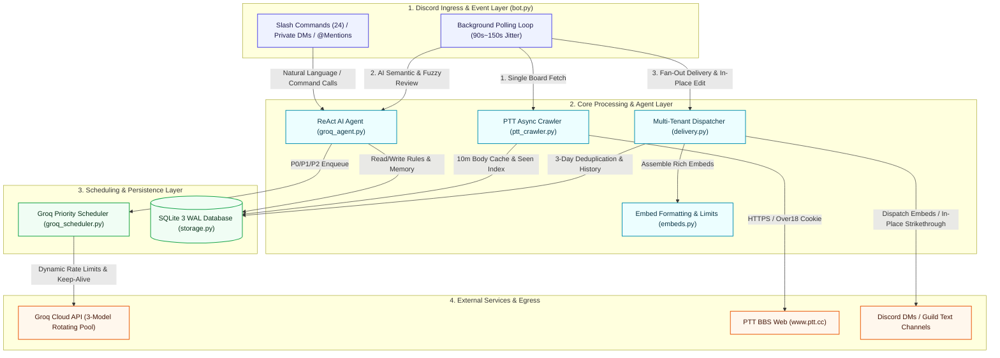
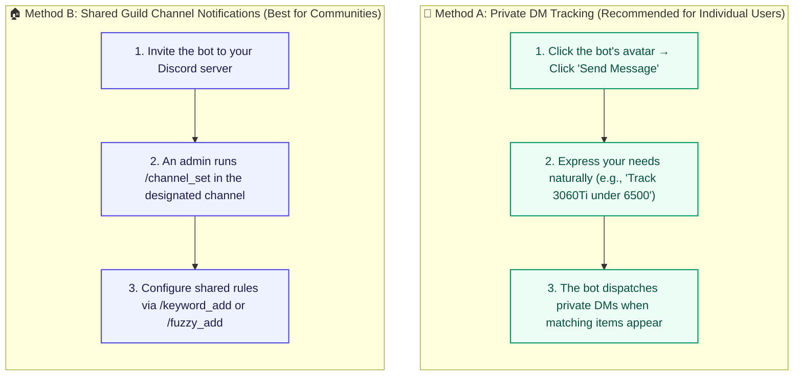

# PTT-DC-Bot: Next-Gen PTT Intelligence & AI Semantic Discord Bot

<div align="center">

**English Version** | [繁體中文版](README.md)

[](https://www.python.org/)
[](https://discordpy.readthedocs.io/)
[](https://groq.com/)
[](https://www.sqlite.org/wal.html)
[](#4-system-architecture--crawl-once-fan-out-pipeline)
[](#5-8-pillar-deep-security-hardening-matrix)
[](#11-automated-testing--verification)
[](LICENSE)

**Engineered for used hardware deal sniping & board monitoring・Say goodbye to stale notifications, channel spam, and API rate limit crashes**

</div>

---

## What is PTT?

> **Cultural Context**: **PTT** (批踢踢實業坊) is Taiwan's largest and most influential terminal-based bulletin board system (telnet BBS), hosting over 1.5 million registered users and serving as Taiwan's primary equivalent to Reddit. Boards like `HardwareSale` (used PC components), `MacShop` (Apple products), and `Gamesale` process thousands of peer-to-peer hardware deals daily. Hot items (e.g., modern GPUs and CPUs) routinely sell out within 1 to 3 minutes of posting.

---

## Table of Contents

- [1. Project Overview & Highlights](#1-project-overview--highlights)
- [2. Pain Points & 13-Dimension Competitor Comparison Matrix](#2-pain-points--13-dimension-competitor-comparison-matrix)
- [3. Five Core Unique Selling Propositions (USPs)](#3-five-core-unique-selling-propositions-usps)
  - [3.1 USP 1: Multi-Tenant SQLite WAL Isolation & Zero-Downtime Migration](#31-usp-1-multi-tenant-sqlite-wal-isolation--zero-downtime-migration)
  - [3.2 USP 2: Groq Multi-Model Priority Scheduler (24,000 TPM Free Tier Load Pool)](#32-usp-2-groq-multi-model-priority-scheduler-24000-tpm-free-tier-load-pool)
  - [3.3 USP 3: ReAct AI Agent with Multi-Layer Security Hardening](#33-usp-3-react-ai-agent-with-multi-layer-security-hardening)
  - [3.4 USP 4: Dual-Tier Precision Sold Detection & Discord In-Place Embed Updates](#34-usp-4-dual-tier-precision-sold-detection--discord-in-place-embed-updates)
  - [3.5 USP 5: Multi-Item Virtual Perspective Views & Price Disambiguation Engine](#35-usp-5-multi-item-virtual-perspective-views--price-disambiguation-engine)
- [4. System Architecture & Crawl-Once Fan-Out Pipeline](#4-system-architecture--crawl-once-fan-out-pipeline)
  - [4.1 Four-Layer Decoupled Architecture](#41-four-layer-decoupled-architecture)
  - [4.2 Crawl-Once Fan-Out Background Pipeline](#42-crawl-once-fan-out-background-pipeline)
- [5. 8-Pillar Deep Security Hardening Matrix](#5-8-pillar-deep-security-hardening-matrix)
- [6. User Guide](#6-user-guide)
  - [6.1 Direct Message (DM) vs Guild Channel Notifications](#61-direct-message-dm-vs-guild-channel-notifications)
  - [6.2 Natural Language AI Assistant Interactions](#62-natural-language-ai-assistant-interactions)
  - [6.3 Exact Keyword Syntax & Rules](#63-exact-keyword-syntax--rules)
  - [6.4 AI Semantic Fuzzy Tracking Rules](#64-ai-semantic-fuzzy-tracking-rules)
  - [6.5 Historical Unsold Item Scanning (`/scan_unsold`)](#65-historical-unsold-item-scanning-scan_unsold)
- [7. Complete Slash Commands Specification (24 Commands)](#7-complete-slash-commands-specification-24-commands)
- [8. Quotas & Tier System](#8-quotas--tier-system)
- [9. Deployment Guide](#9-deployment-guide)
  - [9.1 Docker Compose One-Click Deployment (Recommended)](#91-docker-compose-one-click-deployment-recommended)
  - [9.2 Linux systemd Native Service Setup](#92-linux-systemd-native-service-setup)
  - [9.3 Local Virtual Environment & tmux Daemon](#93-local-virtual-environment--tmux-daemon)
  - [9.4 Environment Configuration (`.env.example`)](#94-environment-configuration-envexample)
- [10. Frequently Asked Questions & Troubleshooting (FAQ)](#10-frequently-asked-questions--troubleshooting-faq)
- [11. Automated Testing & Verification](#11-automated-testing--verification)
- [12. License & Contributing](#12-license--contributing)

---

## 1. Project Overview & Highlights

**PTT-DC-Bot** is an enterprise-grade asynchronous Discord bot engineered to monitor PTT boards with low-latency precision. It seamlessly combines Python's asynchronous networking (`asyncio` + `discord.py` + `aiohttp`), Groq's high-speed LPU inference API, and SQLite 3 WAL for multi-tenant isolation.

Built specifically for fast-paced trading boards (`HardwareSale`, `MacShop`, `Gamesale`, `nb-shopping`, etc.), PTT-DC-Bot introduces five generational advancements:

1. **Zero-Spam In-Place Discord Embed Updates**: After a notification is dispatched, the bot continues tracking the post for up to 18 hours. When the seller marks the item sold in push comments or signatures, the bot modifies the original Discord Embed in-place with a strikethrough—no noisy "item sold" messages cluttering your channels.
2. **Multi-Item Virtual Perspective Views (Token Views)**: When a single post bundles multiple items (e.g., Item 1: GTX 1060 [SOLD], Item 2: RTX 3060Ti [AVAILABLE]), the bot generates isolated virtual views for each subscriber. An item marked sold does not falsely drop the entire post.
3. **Groq Multi-Model Priority Scheduler**: By orchestrating a pool of three alternating LLM models (`120b` ⇄ `27b` ⇄ `20b`), the bot boosts available free throughput to **24,000 TPM** with a four-tier (P0~P3) priority queue, delivering sub-second AI responses at zero operational cost.
4. **Crawl-Once Fan-Out Architecture**: For every monitoring cycle, each active board is fetched exactly once regardless of the number of users subscribed. HTML parsing and LLM inference results are globally cached and distributed, completely eliminating Cloudflare 503 IP bans.
5. **Military-Grade 8-Pillar Security Hardening**: Fully hardened against Prompt Injection, SSRF / Path Traversal, and cross-tenant privilege escalation, balancing community accessibility with robust security.

---

## 2. Pain Points & 13-Dimension Competitor Comparison Matrix

Traditional community monitoring tools typically fall into three categories: legacy services like **PttAlertor**, single-user **Python Webhook scripts**, and generic **RSS bots**. None were designed for modern Discord multi-server operations or complex used-hardware trade negotiations.

The table below provides a comprehensive **13-dimension horizontal technical comparison**:

| # | Dimension | Traditional Webhook Scripts | PttAlertor (Go/Redis) | RSS Bots (e.g., MonitoRSS) | **PTT-DC-Bot (This Project)** |
| :-: | :--- | :--- | :--- | :--- | :--- |
| **1** | **Notification Protocol** | Discord Webhook (One-way) | LINE / Telegram / Messenger | Discord Message (Bot Webhook) | **✅ Discord Native Client (Slash commands, interactive Views, DM & Channels)** |
| **2** | **Multi-Tenant Isolation** | ❌ None (Hardcoded env vars) | ⚠️ Basic User ID keying | ❌ None (Channel-level only) | **✅ Full Multi-Tenancy (SQLite WAL independent rule trees, DM vs Guild row isolation, GDPR cascade purge)** |
| **3** | **Server RBAC Permissions**| ❌ None | ❌ None (Individual account only) | ⚠️ Relies on Discord channel permissions | **✅ Strict RBAC (Only admins/owners modify guild rules; members safely guided to private DMs)** |
| **4** | **Crawler Efficiency** | ❌ Linear $O(N)$ repeated fetches | ⚠️ Centralized scraping | ❌ Bottlenecked by RSS generator delay | **✅ Crawl-Once Fan-Out (Single fetch per board per cycle, shared cache, baseline invariant protection)** |
| **5** | **Sold-Out Detection Depth**| ❌ Title literal match only | ❌ Title match or none | ❌ None (Cannot detect sold status) | **✅ Dual-Tier Funnel (Title regex + Signature push-comment penetration + Groq LLM semantic audit)** |
| **6** | **Stale Message Suppression**| ❌ Stale cards remain forever | ❌ Message severed once sent | ❌ Message severed once sent | **✅ 18h In-Place Dynamic Edit (Embed modified with strikethrough & reason; zero channel spam)** |
| **7** | **Multi-Item Bundled Posts**| ❌ Binary article-level verdict | ❌ Binary article-level verdict | ❌ No item separation | **✅ Virtual Token Views (Independent status, individual pricing, and dedicated pushes per item)** |
| **8** | **Price Disambiguation** | ❌ Naive regex (mistakes models for prices)| ❌ No price filtering | ❌ No price extraction | **✅ Multi-Layer Disambiguation (Masks 3060/12G/750W specs; parses 5.8k abbreviations and colon anchors)** |
| **9** | **AI Natural Language Agent**| ❌ None | ❌ None (Fixed syntax only) | ❌ None | **✅ ReAct AI Agent (Conversational reasoning, board discovery, fuzzy rules, Discord Markdown adaptation)** |
| **10**| **LLM Cost & Rate Control** | ❌ None | ❌ None | ❌ None | **✅ GroqScheduler (P0~P3 priority queue, 3-model 24k TPM rotation pool, header-driven dynamic backoff)** |
| **11**| **Prompt Injection Defense**| ❌ None | ❌ None | ❌ None | **✅ Defense-in-Depth Matrix (<untrusted_ptt_content> tags, state mutation intent locks, XML escaping)** |
| **12**| **Historical Unsold Search**| ❌ None | ❌ None | ❌ None | **✅ `/scan_unsold` Deep Scanner (Backtracks recent posts, push-comment penetration, paginated interactive View)**|
| **13**| **Operating Costs** | Free (Self-hosted, fragile) | ⚠️ LINE Messaging API is costly | Free (Third-party RSS dependency) | **✅ 100% Free & Self-Contained (Groq free-tier pool + local SQLite WAL + Docker container)** |

---

## 3. Five Core Unique Selling Propositions (USPs)

### 3.1 USP 1: Multi-Tenant SQLite WAL Isolation & Zero-Downtime Migration

- **Relational Multi-Tenant Model**:
  The database schema centers on the `subscribers` table, cleanly partitioning `scope = 'user'` (private Direct Messages) from `scope = 'guild'` (shared server channels). All rules (`keywords`), AI fuzzy criteria (`fuzzy_rules`), delivery histories (`deliveries`), conversation memories (`conversation_memory`), and usage counters reference `subscriber_id` with strict `ON DELETE CASCADE` integrity.
- **Privacy & Complete Data Ownership**:
  When users interact with the bot in private DMs, their keywords, budget constraints, and chat logs are completely invisible to server administrators. The `/forget_me` command performs a cascade purge of all personal records, complying with strict GDPR privacy standards.
- **SQLite 3 WAL Concurrency & Smooth Migrations**:
  With `PRAGMA journal_mode=WAL;` and `PRAGMA synchronous=NORMAL;`, readers never block writers. On startup, the engine checks `schema_version` (v1 ➜ v2 ➜ v3), automatically creates an uncommitted `.bak` snapshot, and runs atomic migrations without data loss or downtime.

### 3.2 USP 2: Groq Multi-Model Priority Scheduler (24,000 TPM Free Tier Load Pool)

- **Three-Model Free Tier Rotation (24,000 TPM / 3,000 RPD)**:
  Groq's generous free tier limits each model to 8,000 TPM and 1,000 RPD. Standard continuous polling quickly exhausts these limits, resulting in HTTP 429 errors. `GroqScheduler` manages three distinct model buckets:
  1. `openai/gpt-oss-120b` (Deep semantic reasoning & edge case analysis)
  2. `qwen/qwen3.8-27b` (High-throughput multilingual processing)
  3. `openai/gpt-oss-20b` (Rapid pre-filtering & fallback tasks)
  This architecture triples overall bandwidth to **24,000 TPM / 3,000 RPD**, all within legitimate free-tier usage.
- **Four-Tier Preemptive Priority Queue (P0~P3)**:
  - **P0 (Interactive)**: Direct Messages, `/ai` conversational commands (sub-second preemptive scheduling).
  - **P1 (Realtime)**: Background crawler new-post verification and semantic fuzzy matching.
  - **P2 (Batch Scan)**: `/scan_unsold` batch scanning tasks (yields capacity to P0/P1).
  - **P3 (Maintenance)**: System health checks and daily housekeeping.
- **Header-Driven Dynamic Backoff & Concurrency Locks**:
  The scheduler parses `x-ratelimit-remaining-tokens` and `retry-after` response headers in real time. If a model nears capacity, traffic shifts seamlessly to an idle bucket. Per-user concurrency slots (`acquire_user_slot`) prevent spam from exhausting shared resources.

### 3.3 USP 3: ReAct AI Agent with Multi-Layer Security Hardening

- **ReAct Recursive Function-Calling Engine**:
  `GroqAgent` implements the ReAct (Reasoning + Acting) loop with up to 8 recursive iterations. Equipped with 11 native function-calling tools (`find_ptt_boards`, `verify_and_add_board`, `add_exact_keyword`, `add_fuzzy_rule`, `scan_unsold_articles`, `read_article_detail`, etc.), the agent effortlessly handles complex natural language instructions such as: *"Find the right PTT board for used MacBooks and track any M2 MacBook Air under 25,000 TWD."*
- **Comprehensive Prompt Injection Defenses**:
  - **Untrusted Boundary Isolation**: All external text crawled from PTT is sanitized via `escape_prompt_xml` and wrapped in `<untrusted_ptt_content>` tags.
  - **State Mutation Intent Locks**: If the agent attempts to trigger mutation or deletion tools after reading external PTT content, the tool execution layer verifies whether the user's initial prompt explicitly intended that action. Injected commands embedded inside forum posts are blocked at the code level.
  - **Strict RBAC Enforcement**: Tool executors check the caller's `can_write` flag; unauthorized guild members cannot modify shared server rules via conversational prompts.
- **Dynamic Discord Markdown Adapter**:
  Discord does not render Markdown tables (`| Col | Col |`). The agent includes a built-in formatting adapter that reconstructs tabular data into clean, readable bulleted lists (`• **Field**: Value`) while stripping incompatible HTML tags.

### 3.4 USP 4: Dual-Tier Precision Sold Detection & Discord In-Place Embed Updates

- **Two-Stage Filtering Funnel**:
  - **Stage 1 (Zero-Token Heuristic Extraction)**: Parses title prefixes, brackets, and suffixes. Crucially, it penetrates past the signature block (`※ 發信站: 批踢踢實業坊`) to analyze push comments posted by the author (e.g., `→ author: Deal reached, please do not message`). Whitelist guards prevent false positives on phrases like "sincere seller" or "tentative price".
  - **Stage 2 (AI Semantic Review)**: Combines the body, author updates, and buyer queue messages into a structured prompt evaluated by Groq LLM to verify whether prospective buyers can still purchase the item.
- **Discord In-Place Dynamic Embed Updates**:
  - Traditional bots send a message and abandon it, leaving channels littered with sold-out deals.
  - PTT-DC-Bot persists `message_id` and delivery metadata in SQLite. A background Fair Round-Robin worker continuously re-checks delivered posts from the past 18 hours.
  - Once an item sells, the bot invokes the Discord API to update the original message in-place:
    - Title prefixed with strikethrough: `🔴 [SOLD / CLOSED] ~~Original Title~~`
    - Embed color shifts to muted gray (`0x7f8c8d`)
    - Appends a status field detailing the sale confirmation (e.g., *Author commented: "Sold, please stop mailing"*).
    - **Zero redundant notifications sent to the channel.**

### 3.5 USP 5: Multi-Item Virtual Perspective Views & Price Disambiguation Engine

- **Virtual Token Views for Bundled Posts**:
  When a seller lists multiple items in a single post (e.g., "1. GTX 1060 [SOLD], 2. RTX 3060Ti [AVAILABLE]"), standard crawlers discard the entire post upon encountering the word "sold". PTT-DC-Bot executes `apply_keyword_view` to generate an isolated virtual view for each subscriber. The sold status on Item 1 does not taint Item 2. A buyer tracking the 3060Ti still receives the notification with Item 2's specific price.
- **Hardware Model & Price Disambiguation Regex Engine**:
  The system strips hardware model numbers and spec suffixes (RTX/GTX/RX/i5/DDR5/12G/750W) before price extraction, preventing model numbers like `RTX 3060` from being parsed as a 3,060 TWD price tag. It also converts `5.8k` / `6k` shorthand into `5800` / `6000` and prioritizes currency symbols and colon delimiters.

---

## 4. System Architecture & Crawl-Once Fan-Out Pipeline

### 4.1 Four-Layer Decoupled Architecture



### 4.2 Crawl-Once Fan-Out Background Pipeline


1. **Aggregate Active Boards**: Only boards with active subscribers are polled; empty boards remain dormant.
2. **Single Fetch & Unseen Filter**: Each active board receives exactly one HTTP request per cycle. The `seen_articles` index isolates unseen posts.
3. **Rule Pre-Filter & Token Slicing**: Evaluates all subscriber keywords (including `-exclusions` and numeric boundaries). Extracts the base body and slices distinct virtual perspectives via `apply_keyword_view`.
4. **Groq Semantic Verification**: For-sale posts enter the `P1` queue of `GroqScheduler` to confirm the item is still available and extract item-specific pricing and warranty information.
5. **Multi-Tenant Fan-Out Delivery**: After passing the 3-day deduplication check (`dedupe_hash`), notifications dispatch to private DMs or guild channels according to subscriber configurations.
6. **18h In-Place Sold Updates**: The background worker periodically checks delivered posts from the past 18 hours. When a seller marks an item sold, the original Discord Embed is updated in-place with a strikethrough.

---

## 5. 8-Pillar Deep Security Hardening Matrix

PTT-DC-Bot is built with rigorous security practices, adhering to the findings of extensive code audits and red-blue team assessments:

| Pillar | Threat Model & Target Vulnerabilities | Code-Level Hardening Implementation |
| :--- | :--- | :--- |
| **1. Prompt Injection Defense** | Malicious forum posts embedding instructions to drop rules, alter budgets, or escape prompt boundaries. | 1. External PTT content is sanitized via `escape_prompt_xml` and quarantined in `<untrusted_ptt_content>` tags.<br>2. **Intent Locking Mechanism**: The tool executor blocks state-mutation tools unless the user's initial prompt explicitly intended that action.<br>3. Fuzzy rules use isolated nonce tags to prevent cross-rule leakage. |
| **2. SQL Injection & SSRF Protection** | Malformed board names, SQL injection, or forged URLs coercing the bot into querying internal networks (e.g., AWS Metadata `169.254.169.254`). | 1. 100% of SQLite queries use parameterized placeholders (`?`). Fuzzy queries escape `%` and `_` via `ESCAPE '/'`.<br>2. Regex whitelists restrict URLs to `https://www.ptt.cc/bbs/`. The HTTP client sets `allow_redirects=False` to block 301/302 SSRF pivots. |
| **3. Multi-Tenant RBAC & Isolation** | Unauthorized guild members modifying server-wide rules, cross-server channel hijacking, or data leakage. | 1. Row-level separation between `scope='user'` and `scope='guild'`.<br>2. Strict RBAC: Non-admin members can only modify private DM rules; the tool executor validates the `can_write` flag.<br>3. Channel hijacking guard: Verifies that destination text channels belong to the active interaction guild. |
| **4. Input Sanitization & Bounds Checking**| Extremely long input strings, unauthorized `@everyone` pings, or malformed Markdown crashing embed rendering. | 1. Input sanitization strips `@everyone`, `<@!id>`, `<#channel>`, and custom emoji sequences.<br>2. Keywords capped at 50 chars, fuzzy descriptions at 200 chars; categories whitelisted to `賣/徵/換/情報/ALL`.<br>3. `enforce_embed_limits` truncates payloads at 5,800 characters to prevent Discord 400 Bad Request errors. |
| **5. Rate Limiting & DoS Resilience** | Rapidly invoking `/scan_unsold` or `/search` to exhaust crawler workers, queue capacity, or system memory. | 1. `GroqScheduler` parses rate-limit headers across a 3-model rotating pool (24,000 TPM total).<br>2. Per-user concurrency slots (`acquire_user_slot`) limit users to one active AI task and one search task. `/search` enforces a 10-second cooldown.<br>3. Priority queues enforce maximum size bounds with graceful degradation when saturated. |
| **6. Race Conditions & Concurrency** | Concurrent database writes, WAL checkpoint deadlocks, or corrupt database backups under load. | 1. SQLite WAL mode paired with `threading.RLock()` and a 5,000ms `busy_timeout`.<br>2. Daily maintenance uses SQLite's official `conn.backup()` API for consistent, atomic online snapshots.<br>3. Push deduplication relies on a 3-day SHA-1 hash backed by unique foreign key constraints. |
| **7. Credentials & Info Disclosure** | Exception tracebacks leaking filesystem paths, logs printing API keys, or tokens committed to source control. | 1. Discord responses return sanitized error messages; full stack traces remain in internal logs.<br>2. Entrypoint applies `os.umask(0o077)` so database and log files are readable only by the process owner.<br>3. Zero hardcoded secrets; all tokens are injected exclusively via environment variables. |
| **8. Container Hardening & Least Privilege**| Containers running as root, writable application directories facilitating backdoor persistence, or unconstrained host resources. | 1. Dockerfile establishes a non-root `botuser` (UID 1000). The app directory is set to `root:root (0755)` read-only, with write permissions restricted to `/app/data`.<br>2. Docker Compose applies `no-new-privileges:true`, `cap_drop: [ALL]`, a 512MB memory limit, 1.0 CPU cap, and automated health checks. |

---

## 6. User Guide

### 6.1 Direct Message (DM) vs Guild Channel Notifications



> [!TIP]
> **DM User Notice**: Ensure that your Discord *User Settings > Privacy & Safety* allows "Direct Messages from server members". If delivery was previously paused due to delivery errors, simply send any message to the bot to automatically re-enable notifications.

### 6.2 Natural Language AI Assistant Interactions

Send a direct message or use `/ai` in a channel. The assistant will parse your intent and call the appropriate tools automatically:

- **Track Hardware Model & Budget**:
  > *"Track RTX 4070 Super on HardwareSale with a budget under 18,000 TWD."*
- **Compound Fuzzy Conditions**:
  > *"I want to track a non-mining 3060Ti in Taipei with at least one year of warranty, budget 6,500."*
- **Intelligent Board Discovery**:
  > *"I want to buy a used MacBook or laptop. Find the appropriate PTT boards and add them to my watchlist."*
- **Scan Historical Unsold Items**:
  > *"Scan HardwareSale for unsold RX 6700XT cards currently available."*
- **List Active Settings**:
  > *"Show all my currently configured keywords and tracking rules."*

### 6.3 Exact Keyword Syntax & Rules

Use `/keyword_add` to set up high-speed matching rules that do not consume your daily AI quota:

- **Whitespace (Logical AND)**: `Taipei 3060TI` (Matches posts containing both "Taipei" and "3060TI").
- **Exclusion Prefix (`-`)**: `3060 -ti -laptop -mining` (Matches pure 3060 cards while excluding 3060Ti, laptops, and mining cards).
- **Price Cap (`max_price`)**: Set to `6500` to automatically ignore posts priced above 6,500 TWD.

### 6.4 AI Semantic Fuzzy Tracking Rules

Use `/fuzzy_add` to track nuanced, subjective requirements:
- `description`: Describe your desired product condition, warranty requirements, or specific constraints.
- `hint_keywords` (Highly recommended): Comma-separated pre-filter keywords (e.g., `3060,3060ti`). LLM evaluation activates only when these hints match, preserving system resources and expediting notifications.

### 6.5 Historical Unsold Item Scanning (`/scan_unsold`)

Looking for hardware that is currently available right now?
- Run `/scan_unsold keyword: 3060TI`
- The system crawls recent posts, validates signatures and push comments, runs semantic checks to filter out closed or reserved deals, and renders an interactive, paginated card listing verified available items and prices.

---

## 7. Complete Slash Commands Specification (24 Commands)

PTT-DC-Bot implements 24 global Discord Slash commands:

### 7.1 AI Assistant & Live Search

| Command | Arguments | Permissions | Description |
| :--- | :--- | :--- | :--- |
| `/ai` | `prompt` (Required), `scope` (auto/user/guild) | Everyone (Writes require RBAC) | Natural language interface to discover boards, set rules, or analyze market prices. |
| `/scan_unsold` | `keyword` (Optional), `board` (Default: HardwareSale), `max_per_keyword` (1~8), `push_to_channel` (Bool), `scope` | Everyone (Quota-managed) | Deep scans historical posts for verified available items with paginated Views. |
| `/search` | `keyword` (Required), `board` (Default: HardwareSale), `pages` (1~2) | Everyone (No quota consumed) | Directly queries PTT search without filtering sold-out statuses. |

### 7.2 Exact Keyword Management (`/keyword_*`)

| Command | Arguments | Permissions | Description |
| :--- | :--- | :--- | :--- |
| `/keyword_add` | `keyword` (Required), `board`, `category`, `max_price`, `scope` | User / Guild Admin | Adds an exact keyword rule with AND spaces, `-` exclusions, and price caps. |
| `/keyword_edit` | `keyword_id` (Autocomplete), `new_keyword`, `max_price`, `scope` | User / Guild Admin | Modifies an existing keyword or adjusts its budget cap. |
| `/keyword_remove`| `keyword` (Autocomplete), `scope` | User / Guild Admin | Removes a specific keyword by ID or string. |
| `/keyword_list` | `scope` (Optional) | Everyone (Read-only) | Displays all active keywords, fuzzy rules, and channel settings for the scope. |
| `/keyword_clear`| `scope` (Optional) | User / Guild Admin | Clears all exact keywords in the selected scope in one action. |

### 7.3 AI Semantic Fuzzy Rules (`/fuzzy_*`)

| Command | Arguments | Permissions | Description |
| :--- | :--- | :--- | :--- |
| `/fuzzy_add` | `description` (Required), `board`, `category`, `hint_keywords`, `scope` | User / Guild Admin | Adds a natural language AI semantic tracking rule. |
| `/fuzzy_remove` | `rule` (Autocomplete), `scope` | User / Guild Admin | Removes a fuzzy rule by ID or text snippet. |
| `/fuzzy_list` | `scope` (Optional) | Everyone (Read-only) | Displays all configured AI fuzzy tracking rules in the scope. |

### 7.4 Board Monitoring (`/board_*`)

| Command | Arguments | Permissions | Description |
| :--- | :--- | :--- | :--- |
| `/board_add` | `board` (Required), `scope` | User / Guild Admin | Validates a PTT board, adds it to the monitoring loop, and performs baseline sync. |
| `/board_remove` | `board` (Autocomplete), `scope` | User / Guild Admin | Removes a board from tracking; polling stops if no subscribers monitor it. |
| `/board_list` | None | Everyone (Read-only) | Displays all currently monitored PTT boards, index counts, and check timestamps. |

### 7.5 Notification Channels & Account Management

| Command | Arguments | Permissions | Description |
| :--- | :--- | :--- | :--- |
| `/channel_set` | `channel` (Optional), `scope` | User / Guild Admin | Sets the notification text channel (omit argument to route notifications to DMs). |
| `/push_mode` | `mode` (`keyword`/`all`), `scope` | Bot Owner Only | Toggles between keyword-only matching and full firehose mode. |
| `/pause` | `scope` (Optional) | User / Guild Admin | Pauses automated notifications while preserving all rules. |
| `/resume` | `scope` (Optional) | User / Guild Admin | Resumes automated notifications for the scope. |
| `/me` | None | Everyone (Ephemeral) | Displays personal tracking rules, DM status, and remaining daily quota. |
| `/forget_me` | None | Everyone (Ephemeral) | GDPR Purge: Permanently deletes all personal rules, history, and memories. |
| `/status` | `scope` (Optional) | Everyone (Read-only) | Shows system health metrics, Groq queue loads, and anti-ban cooldowns. |
| `/check_now` | None | Everyone (5m cooldown) | Manually triggers an immediate crawl cycle across all active boards. |
| `/admin` | `action`, `target_id`, `tier` | Bot Owner Only | Administrative console to inspect tenants, adjust quotas, and manage blacklists. |
| `/help` | None | Everyone | Shows the interactive user guide, DM instructions, and syntax examples. |

---

## 8. Quotas & Tier System

Hierarchical quotas ensure fair resource distribution across all subscribers:

| Quota Dimension | Private DM User (`friend`) | External Guild (`free`) | Bot Owner / Host Guild (`owner`) |
| :--- | :---: | :---: | :---: |
| **Max Exact Keywords** | 30 | 10 | 999 |
| **Max AI Fuzzy Rules** | 8 | 3 | 999 |
| **Max Monitored Boards** | 5 | 5 | 20 (Global hard cap: 25) |
| **Daily AI Conversations (`/ai` / DM)** | 60 / day | 20 / day | Unlimited |
| **Daily Unsold Scans (`/scan_unsold`)** | 25 / day | 8 / day | Unlimited |
| **Concurrent Task Slot** | 1 AI + 1 Scan | 1 AI + 1 Scan | 1 AI + 1 Scan |
| **Max Notifications per Cycle** | 5 (Overflow folded into summary) | 5 (Overflow folded into summary) | 5 (Overflow folded into summary) |

> [!NOTE]
> Automated keyword matching and fuzzy evaluations executed during background polling use the **shared background system queue** and **do not consume** user daily conversation or scan quotas!

---

## 9. Deployment Guide

### 9.1 Docker Compose One-Click Deployment (Recommended)

The repository includes a production-ready `Dockerfile` and `docker-compose.yml` pre-configured with non-root security boundaries:

```bash
# 1. Clone repo and prepare environment configuration
cp .env.example .env
chmod 600 .env
nano .env  # Enter your DISCORD_TOKEN and GROQ_API_KEY

# 2. Create the host directory for database persistence
mkdir -p data

# 3. Build and launch the container in detached mode
docker compose up -d --build

# 4. View real-time logs
docker compose logs -f

# 5. Stop the service
docker compose down
```

### 9.2 Linux systemd Native Service Setup

For native Linux host deployments, utilize the included systemd unit template:

```bash
# 1. Copy and configure the service unit file
sudo cp ptt-bot.service /etc/systemd/system/ptt-bot.service
sudo nano /etc/systemd/system/ptt-bot.service

# 2. Reload systemd and enable service on boot
sudo systemctl daemon-reload
sudo systemctl enable --now ptt-bot

# 3. Inspect service health and logs
sudo systemctl status ptt-bot
journalctl -u ptt-bot -f
```

### 9.3 Local Virtual Environment & tmux Daemon

```bash
# 1. Create a virtual environment and install dependencies
python3 -m venv venv
source venv/bin/activate
pip install -r requirements.txt

# 2. Launch the tmux background daemon (auto-restart and rotating log protection)
bash restart_bg.sh

# 3. Follow application logs
tail -f bot.log

# 4. Stop the daemon
bash stop_bg.sh
```

### 9.4 Environment Configuration (`.env.example`)

```ini
# Discord Application Bot Token (Required)
DISCORD_TOKEN=your_discord_bot_token_here

# Default Delivery Target (Optional, can be set later via /channel_set)
DEFAULT_CHANNEL_ID=123456789012345678
DEFAULT_GUILD_ID=987654321098765432
OWNER_USER_ID=

# Default Board and Polling Interval Jitter (Seconds)
DEFAULT_BOARD=HardwareSale
POLL_INTERVAL_MIN=90
POLL_INTERVAL_MAX=150

# Groq Cloud API Configuration (Required for AI Features)
GROQ_API_KEY=gsk_your_groq_api_key_here
GROQ_MODEL=openai/gpt-oss-120b
GROQ_FAST_MODEL=openai/gpt-oss-20b

# Persistence & Log Paths (Set to /app/data/... inside Docker)
DB_PATH=bot_data.db
LOG_PATH=bot.log
LOG_TO_STDOUT=1
```

---

## 10. Frequently Asked Questions & Troubleshooting (FAQ)

### Q1: I configured rules in private DMs, but I am not receiving notifications when new matching posts appear.
1. Run `/me` to inspect your subscriber profile:
   - If status says **"Push notifications paused"**, run `/resume` to re-enable them.
   - If status says **"DM delivery failed previously"**, your Discord privacy settings blocked the bot. Open Discord *User Settings > Privacy & Safety*, enable "Allow direct messages from server members", and then **send any message to the bot** to clear the pause flag.

### Q2: Why wasn't a post that seems to match my keyword delivered or listed in `/scan_unsold`?
The two-tier filter drops posts matching any of these criteria:
1. The post is older than 21 days.
2. The post title or author push comments contain closed/sold indicators (e.g., `sold`, `reserved`, `deal reached`, `stop mailing`, `mailbox full`).
3. The seller reposted the same item within 3 days (3-day SHA-1 deduplication filter).
4. The item price exceeds your configured `max_price` budget constraint.
To inspect all historical posts regardless of sold status, use the `/search` command.

### Q3: When I run a command in a guild text channel, the bot replies with "Insufficient Permissions".
Commands run in guild channels target the server's shared configuration by default, which requires server management permissions. To manage your private rules:
- Send a **Direct Message (DM)** to the bot (recommended).
- Or specify `scope: 👤 Personal Tracking` when executing the slash command.

---

## 11. Automated Testing & Verification

PTT-DC-Bot maintains complete test suites using synthesized offline payloads and ephemeral SQLite WAL databases, ensuring tests execute with 100% zero leftover disk artifacts (Zero-Trash):

```bash
# Execute the full unit and security integration suite
python3 -m unittest discover -s tests -p "test_*.py" -v
```

The test suite covers:
- SQLite WAL schema migrations (v1 ➜ v2 ➜ v3) and foreign key cascade deletion
- Multi-tenant isolation between user DMs and guild channel rule sets
- Baseline invariant preservation during transient PTT 503 errors (prevents historical notification storms)
- Signature block and author push comment penetration for sold detection
- Multi-item virtual perspective view (`apply_keyword_view`) slicing
- Hardware model spec masking and normalized price disambiguation
- Prompt injection quarantine and RBAC state-mutation gating
- SSRF and path traversal URL validation

---

## 12. License & Contributing

Distributed under the [MIT License](LICENSE). Contributions, bug reports, and pull requests from the global open-source community are warmly welcomed!
