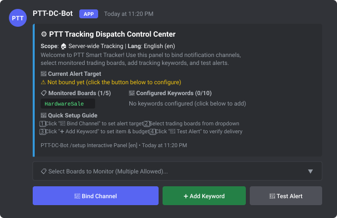
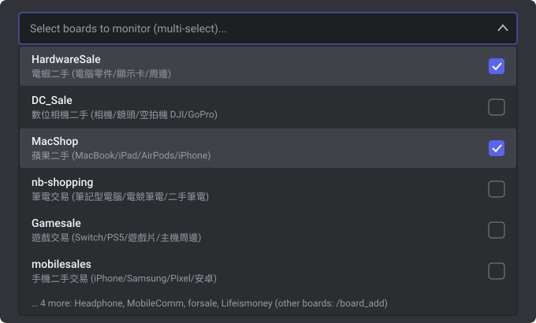
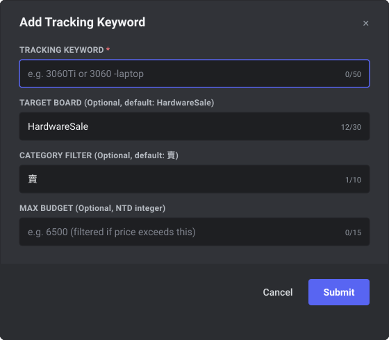
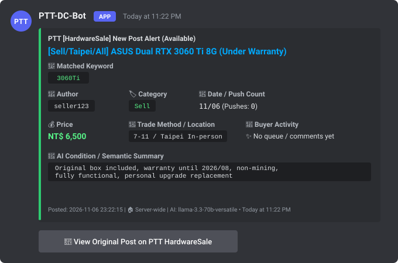

# PTT-DC-Bot

**English** | [繁體中文](README.md)

[](https://www.python.org/)
[](https://discordpy.readthedocs.io/)
[](https://groq.com/)
[](https://github.com/jasonxp516/ptt-dc-bot/pkgs/container/ptt-dc-bot)
[](https://www.sqlite.org/wal.html)
[](LICENSE)

An asynchronous PTT (Taiwan Bulletin Board System) board monitor and multi-platform push notification bot (supporting Discord, Telegram, and Email SMTP) combining deterministic rule-based filtering with Groq LLM semantic reasoning.

Built specifically for high-velocity second-hand trading boards (`HardwareSale`, `MacShop`, `nb-shopping`, `Gamesale`, `MobileComm`, etc.), PTT-DC-Bot resolves the common pain points of traditional alert bots: dead notifications for already-sold items, missed products in multi-item listings, and hardware model specifications being misidentified as asking prices.

---

## Why PTT-DC-Bot? (Key Differences from Existing Tools)

Most existing PTT alert solutions (such as PttAlertor, RSS bots, or basic webhook scripts) rely strictly on simple title keyword matching and one-way notification pushing. When monitoring fast-moving marketplace boards, several critical issues arise. PTT-DC-Bot solves them by design:

1. **18-Hour In-Place Status Updates (Zero Channel Spam)**  
   Traditional bots abandon a post once pushed, leaving notification channels cluttered with stale, sold-out listings. PTT-DC-Bot actively monitors delivered posts for up to 18 hours. It tracks both title edits and **the original author's latest post-signature comments** (e.g., "sold", "reserved", "pending", "no more emails"). Upon detecting a completed deal, it **edits the original Discord embed in-place with a strikethrough** without sending repetitive messages.
2. **Isolated Multi-Item Post Slicing**  
   When a seller lists multiple products in a single post (e.g., `1. GTX 1060 (Sold) / 2. RTX 3060Ti $5800`), standard scrapers discard the entire post upon finding the word "Sold". PTT-DC-Bot creates independent virtual views for each keyword, accurately tracking price and availability for each item separately.
3. **Hardware Model vs. Price Disambiguation**  
   Built-in masking filters prevent hardware specifications like `RTX 3060`, `12G`, `750W`, or `i5-12400` from being parsed as prices. The engine also normalizes shorthand price notations (such as `5.8k` → 5,800 TWD) for reliable budget filtering.
4. **Natural Language Setup & Zero-Cost Semantic Verification**  
   Integrated with Groq's free-tier LLM API, users can define tracking rules in plain natural language (e.g., *"Track RTX 3060Ti under 6,500 TWD with original warranty in Taipei"*). A dynamic rotation pool across 3 free models (~24,000 TPM combined) and a P0–P3 priority queue ensures real-time background inspection without triggering rate limits.
5. **Unified Multi-Tenant Architecture (Server Channels + Personal DMs)**  
   Powered by SQLite in WAL mode, a single bot instance simultaneously powers public server channels and private direct messages. Individual members can DM the bot to maintain independent watchlists and quotas completely isolated from the server.

<details>
<summary><b>Click to expand: Feature Comparison Matrix (vs. PttAlertor / Webhook Scripts / RSS Bots)</b></summary>
<br>

| Evaluation Criteria | Basic Webhook Scripts | PttAlertor | RSS Notification Bots | **PTT-DC-Bot (This Project)** |
| :--- | :--- | :--- | :--- | :--- |
| **Interaction Model** | One-way push (config file edits) | LINE / Telegram text commands | Slash commands (URL only) | **Native Slash commands + Interactive `/setup` UI + Natural language DM chat** |
| **Multi-Tenancy** | None (single static configuration) | Per user account | Per channel | **Shared guild channel broadcasts + isolated personal DM watchlists** |
| **Sold Detection** | Title keyword only | Title keyword or none | None | **Title regex + post-signature author comments + LLM semantic review** |
| **Stale Post Handling** | None | None | None | **In-place Discord embed edit with strikethrough (18-hour tracking window)** |
| **Multi-Item Posts** | Whole-post judgment | Whole-post judgment | None | **Per-keyword virtual view slicing for independent status & price parsing** |
| **Budget Filtering** | Basic regex (prone to model false-hits) | None | None | **Hardware model shielding, `k`-unit parsing, and max price limits** |
| **Historical Stock Scan** | None | None | None | **`/scan_unsold` command to scan recent posts for available items** |
| **Crawler Efficiency** | Redundant fetches per subscription | Centralized polling | Dependent on RSS feed cache | **Crawl-Once, Fan-Out with shared article content and AI judgment caches** |

</details>

---

## Quick Start & Deployment: 3 Streamlined Options

Before running the bot, please prepare the free credentials for your preferred notification platform(s):
1. **Discord Bot Token (if using Discord)**: Open the [Discord Developer Portal](https://discord.com/developers/applications), create an Application, navigate to the **Bot** tab, and click **Reset Token**. **Privileged Gateway Intents, including Message Content Intent, do not need to be enabled**: Discord natively provides message content for DMs, explicit `@Bot` mentions, and Slash commands.
2. **Telegram Bot Token (if using Telegram)**: Open Telegram, message [@BotFather](https://t.me/BotFather), run `/newbot`, and copy the HTTP API token provided.
3. **Gmail App Password (if using Email SMTP)**: In your Google Account, enable 2-Step Verification and generate a 16-character [App Password](https://myaccount.google.com/apppasswords).
4. **Groq API Key (Optional)**: Sign up at [Groq Console](https://console.groq.com/keys) and click **Create API Key** (starts with `gsk_...`) for natural language AI assistance and semantic filtering.

---

### Method 1: One-Liner Automatic Installation (Fastest Setup)

Open your terminal (Terminal on Linux/macOS or PowerShell on Windows) and paste the command for your operating system. The script automatically handles downloading, virtualenv provisioning, dependency installation, setup wizard execution, invite link generation, and service startup:

#### Linux / macOS
```bash
curl -fsSL https://raw.githubusercontent.com/jasonxp516/ptt-dc-bot/main/install.sh | bash
```

#### Windows (PowerShell)
```powershell
irm https://raw.githubusercontent.com/jasonxp516/ptt-dc-bot/main/install.ps1 | iex
```

*Key Highlights*:
- Automatically detects Python 3.10+ (on Windows, prompts to auto-install via `winget` if missing).
- Automatically provisions an isolated virtual environment (`.venv`), keeping your global Python clean.
- Automatically launches the interactive setup wizard—simply paste your Token and Key when prompted.
- Provides immediate startup options (Linux supports starting in a background `tmux` session).

---

### Method 2: GitHub Releases Double-Click Bundles (Zero-Command GUI)

Ideal for users who prefer graphical double-click launchers without running terminal commands:

1. Visit the project's [GitHub Releases page](https://github.com/jasonxp516/ptt-dc-bot/releases) and download the pre-packaged archive for your platform:
   - **Windows**: Download `ptt-dc-bot-<version>-windows.zip`
   - **macOS**: Download `ptt-dc-bot-<version>-macos.tar.gz`
   - **Linux**: Download `ptt-dc-bot-<version>-linux.tar.gz` (e.g., `ptt-dc-bot-v1.0.0-beta.1-linux.tar.gz`)
2. Extract the archive into any folder on your computer (e.g., Desktop or personal documents; on Linux run `tar -xzf ptt-dc-bot-*-linux.tar.gz`).
3. Run the launcher:
   - **On Windows**: Double-click **`start_windows.bat`**
   - **On macOS**: Double-click **`start_mac.command`**
   - **On Linux**: In the extracted directory, run **`./install.sh`** for initial setup (or run `./start_bg.sh` for daemon mode / `python3 bot.py` for foreground execution)
4. On first launch, the environment will initialize automatically and launch the configuration wizard. Paste your credentials when prompted, and the bot will start immediately.

*Watchdog Recovery*:
- The Windows launcher includes an automatic crash-recovery watchdog: if the bot encounters a network glitch or abnormal termination, it will automatically restart after 10 seconds. Closing the window or cancelling setup exits cleanly.

---

### Method 3: Docker Compose & GHCR Pre-Built Images

Ideal for Linux servers, Raspberry Pi, home labs, or NAS (Synology / unRAID / QNAP) container deployments. Pre-built multi-architecture images (`linux/amd64` and `linux/arm64`) are published to: `ghcr.io/jasonxp516/ptt-dc-bot:latest`.

#### 1. Standard Docker Compose Deployment

Create a working directory and configuration files:

```bash
mkdir -p ptt-dc-bot/data && cd ptt-dc-bot

# Download official docker-compose.yml and configuration template
curl -fsSL https://raw.githubusercontent.com/jasonxp516/ptt-dc-bot/main/docker-compose.yml -o docker-compose.yml
curl -fsSL https://raw.githubusercontent.com/jasonxp516/ptt-dc-bot/main/.env.example -o .env

# Set secure permissions and edit credentials
chmod 600 .env
nano .env
```

Fill in your credentials in `.env`:
```ini
DISCORD_TOKEN=your_discord_bot_token_here
GROQ_API_KEY=your_groq_api_key_here
```

Start the container:
```bash
# Pull the latest pre-built GHCR image and start in background
docker compose pull && docker compose up -d

# View real-time logs (startup confirms with "Logged in as ...")
docker compose logs -f

# Stop service
docker compose down
```

`docker-compose.yml` comes pre-configured with principle of least privilege (`cap_drop: ALL`, `no-new-privileges: true`), resource limits (1.0 CPU, 512MB RAM), and database volume persistence (`./data:/app/data`).

---

#### 2. Synology NAS (Container Manager) Deployment

1. **Prepare Directory & Config**:
   - Open DSM **File Station** and create the directory structure under the `docker` shared folder:
     ```text
     /docker/ptt-dc-bot/
     ├── .env           (Text file containing DISCORD_TOKEN and GROQ_API_KEY)
     └── data/          (Empty folder for SQLite database and log persistence)
     ```
2. **Create Project in Container Manager**:
   - Open **Container Manager**, switch to the **Project** tab.
   - Click **Create**:
     - **Project Name**: `ptt-dc-bot`
     - **Path**: Select the `/docker/ptt-dc-bot` directory created above.
     - **Source**: Select "Create docker-compose.yaml" and paste the contents of `docker-compose.yml`.
   - Click Next. Container Manager will download `ghcr.io/jasonxp516/ptt-dc-bot:latest` and start the container.
3. **Verify Operation**:
   - Click container **Details** → **Log**, and confirm output includes `Logged in as ...`.

---

#### 3. unRAID Container Deployment

1. Open the unRAID Web GUI, go to the **Docker** tab, scroll to the bottom and click **Add Container**.
2. Configure container parameters:
   - **Name**: `ptt-dc-bot`
   - **Repository**: `ghcr.io/jasonxp516/ptt-dc-bot:latest`
   - **Restart Policy**: `unless-stopped`
3. Click **Add another Path, Port, Variable, or Device** to add:
   - **Path**:
     - Container Path: `/app/data`
     - Host Path: `/mnt/user/appdata/ptt-dc-bot`
     - Access Mode: `Read/Write`
   - **Variables**:
     - Name: `DISCORD_TOKEN`, Value: `your_discord_bot_token_here`
     - Name: `GROQ_API_KEY`, Value: `your_groq_api_key_here`
     - Name: `TZ`, Value: `Asia/Taipei`
4. Click **Apply**. The container will be created and run continuously in the background.

---

## Multi-Platform Support & Platform Comparison Matrix

Starting with the Beta release, PTT-DC-Bot features a decoupled Provider & Dispatcher architecture (`delivery.py`), allowing a single crawler engine to broadcast notifications across multiple messaging platforms simultaneously. Users can configure any combination of Discord, Telegram, and Email via the interactive setup wizard (`setup_wizard.py`).

To provide full transparency on platform trade-offs and explain why certain platforms (such as LINE) are not supported, the following matrix compares the four major communication services:

| Evaluation Dimension | Discord (Production v1.0.0) | Telegram Bot (Beta Expansion) | Email SMTP (Beta Expansion) | LINE Messaging API (Restricted / Unsupported) |
| :--- | :--- | :--- | :--- | :--- |
| **Operating Cost** | [Zero Cost] 100% Free | [Zero Cost] 100% Free | [Zero Cost] 100% Free (Gmail / custom SMTP) | [High Cost] 200 free pushes/mo; paid tiers start at NT$800+/mo (~$25 USD) |
| **Connection & NAT** | Outbound WebSocket Gateway (No public IP / SSL needed) | Outbound Long Polling (`getUpdates`) (No public IP / SSL needed) | Outbound SMTP TCP (Port 587 STARTTLS / Port 465 SSL) | [Strict Requirement] Requires public HTTPS Webhook URL with valid CA SSL |
| **Push Quota & Limits** | Unlimited (Standard Discord rate limits) | Unlimited (30 msg/s broadcast limit) | ~500 emails/day (Personal Gmail free limit) | [Hard Limitation] Capped at 200 active push messages/month total |
| **Interactive Commands** | Native Slash Commands, buttons, select menus, modal dialogs | Text slash commands (`/start`, `/keyword_add`, etc.), inline keyboard | None (One-way push only; bidirectional requires IMAP polling) | Webhook server required with custom command parsing |
| **In-Place Sold Updates** | [Supported] Edits original message embed with strikethrough | [Supported] `editMessageText` updates message in-place with strikethrough | [Unsupported] Sent emails cannot be modified retroactively | [Impractical] Requires sending additional push messages, draining quota |
| **Extra Dependencies** | `discord.py` | [Zero New Dependencies] Reuses existing `aiohttp` | [Zero New Dependencies] Standard library `smtplib` + `asyncio.to_thread` | Requires external HTTP web server framework and reverse proxy |
| **Primary Use Case** | Discord server community broadcast & personal DM alerts | Private instant mobile alerts & cross-platform messaging | Long-term high-value post archiving & desktop email notifications | Infeasible for open-source self-hosted setups |
| **Feasibility Status** | **Production Supported (v1.0.0)** | **Supported in Beta (Recommended)** | **Supported in Beta (Recommended)** | **Infeasible (Technical & Economic Barriers)** |

*Key Takeaways*:
- **Discord & Telegram**: Recommended for real-time bidirectional interaction, rich UI buttons, and 18-hour in-place post updates when items sell out.
- **Email (SMTP)**: Recommended for persistent notification archiving and zero-tunneling operation across desktop and mobile devices.
- **LINE**: Infeasible due to LINE Notify service shutdown on March 31, 2025, and the 200/month push ceiling on LINE Messaging API.

---

## Platform Setup Guides & Onboarding (Click to expand)

PTT-DC-Bot supports modular notification delivery. You may configure any combination of Discord, Telegram, and Email. Step-by-step setup guides for each platform, along with an in-depth feasibility analysis of LINE, are organized below:

<details>
<summary><b>[Guide] Discord Bot Setup & Channel Configuration</b></summary>
<br>

### 1. Adding the Bot to Your Server (OAuth2 Permissions)

- **Auto-Generated Invite Link**:  
  When using the installation script or double-click launcher, the setup wizard validates your Token and automatically prints your dedicated OAuth2 invite URL with permissions integer `274877975552`. Simply open the link in your browser and select your server.
- **Manual Invite Verification**:  
  If creating an invite URL manually, ensure it includes Scopes `bot` and `applications.commands`, with the following Bot Permissions:
  - `View Channels`
  - `Send Messages`
  - `Embed Links` (required for notification cards)
  - `Read Message History`

> **[Important]**: Do **not** enable Privileged Gateway Intents for this bot. Discord natively provides message content for DMs, explicit `@Bot` mentions, and Slash commands, so Message Content Intent is not required.

---

### 2. First-Boot Owner Welcome DM (Clean Boot)

When the bot connects to Discord for the first time with a clean database (no bound channels and no keywords configured):
1. The terminal prints a prominent startup guide notice:
   ```text
   ========================================================================
   [PTT-DC-Bot] 首次啟動導引：
   機器人已成功登入！請在 Discord 伺服器或私訊中輸入 /setup 快速完成推播與看板設定。
   ========================================================================
   ```
2. The bot automatically sends a welcome onboarding DM to the Application Owner (the bot's creator), providing 4 quick start steps and a summary of core commands.

---

### 3. The `/setup` Visual Dashboard

Type `/setup` in any server text channel (or inside a private DM with the bot) to open the visual control panel:

<p align="center">
  
</p>

Four-step walkthrough:

1. **Step 1: Click "Bind Channel"**  
   - Binds the current text channel as the notification target for the server with one click.
   - If clicked inside a private DM with the bot, sets the destination to your personal DM.
2. **Step 2: Select Boards in "Select Boards to Monitor" Dropdown**  
   - The dropdown menu is pre-populated with top trading boards:
     - `HardwareSale`: PC hardware (GPUs, CPUs, RAM, power supplies, peripherals)
     - `MacShop`: Apple marketplace (MacBooks, iPhones, iPads, Apple accessories)
     - `nb-shopping`: Laptops & notebooks (Gaming laptops, ultrabooks)
     - `Gamesale`: Video games (Consoles, PS5/Switch game cartridges)
     - `MobileComm`: Mobile communications (Smartphones, cellular hardware)
   - Supports single or multiple selections. Selecting boards establishes initial baselines immediately without spamming historical posts.

<p align="center">
  
</p>

3. **Step 3: Click "Add Keyword" (Modal Form)**  
   - Opens a pop-up modal dialog with 4 structured fields:
     - **Tracking Keyword (Required)**: Supports space AND logic (e.g., `3060Ti Taipei`) and minus exclusion (e.g., `3060 -laptop -mining`).
     - **Target Board (Optional)**: Defaults to `HardwareSale`.
     - **Category Filter (Optional)**: Defaults to `賣` (Selling, excluding buying/WTS requests).
     - **Max Budget (Optional)**: Numeric budget ceiling in NTD integer (e.g., `6500`). Posts priced higher than this amount are filtered out automatically.

<p align="center">
  
</p>

4. **Step 4: Click "Test Alert"**  
   - Dispatches a fully formatted test notification embed to the bound channel/DM immediately.
   - Confirms that the bot possesses send and embed permissions and verifies card rendering.

<p align="center">
  
</p>

</details>

<details>
<summary><b>[Guide] Telegram Bot Setup & Push Binding</b></summary>
<br>

### 1. Create a Bot via @BotFather

1. Open Telegram and search for the official [@BotFather](https://t.me/BotFather).
2. Send `/start`, then send `/newbot`.
3. Follow the prompts to provide:
   - **Bot Display Name**: e.g., `My PTT Tracker`
   - **Bot Username**: Must end in `bot` (e.g., `my_ptt_tracker_bot`).
4. @BotFather will return your HTTP API Token:
   ```text
   Use this token to access the HTTP API:
   123456789:ABCdefGhIJKlmNoPQRsTUVwxyZ_1234567
   ```
5. *(Optional)* Configure slash commands auto-completion by sending `/setcommands` to @BotFather:
   ```text
   start - Register and activate push notifications
   keyword_add - Add keyword tracking rule
   keyword_list - View and manage active rules
   pause - Pause push notifications
   resume - Resume push notifications
   status - Check system and crawler status
   me - View personal quotas and subscription ID
   help - Display usage manual
   ```
   *(Note: The bot also automatically registers these commands on startup via `setMyCommands`).*

---

### 2. Retrieve Push Target Chat ID

- **Personal DM Alerts**:
  1. Open your bot in Telegram (search for `@your_bot_username` or click its `t.me` link).
  2. Click **Start** or send `/start`. The bot initializes your subscription and displays your personal `Chat ID` (e.g., `123456789`).
  3. You may also look up your ID via [@userinfobot](https://t.me/userinfobot) or [@raw_data_bot](https://t.me/raw_data_bot).
- **Group Notifications**:
  1. Add your bot to the target Telegram group.
  2. Send `/start` inside the group to obtain the group Chat ID (a negative integer, e.g. `-1001234567890`).

---

### 3. Configure Environment Variables

Run the setup wizard (`python3 setup_wizard.py`) and enter option `2` (or `1,2` for both Discord and Telegram). The wizard validates your Telegram token against `api.telegram.org` using standard Python libraries.

Alternatively, set the variables directly in `.env`:
```ini
ENABLE_TELEGRAM=true
TELEGRAM_BOT_TOKEN=123456789:ABCdefGhIJKlmNoPQRsTUVwxyZ_1234567
TELEGRAM_CHAT_ID=123456789
```

---

### 4. Interactive Commands & Rules Management

- `/start`: Register subscription and view welcome card with Chat ID.
- `/help`: Display operational guide with syntax and parameter examples.
- `/keyword_add <keyword> [max_price]`: Add a tracking rule (e.g., `/keyword_add 4070Super 18000`; or explicit syntax `/keyword_add HardwareSale 賣 3060Ti 6500`).
- `/keyword_list`: List active tracking rules. Each rule includes an inline keyboard button for one-click deletion.
- `/pause` and `/resume`: Temporarily pause or resume push alerts without losing rules.
- `/status`: Check crawler synchronization status and post counts.
- `/me`: View personal subscription status and limits.

---

### 5. Advanced Features

- **PTT Web Link Button**: Every notification card features an inline URL button linking directly to the original PTT post.
- **In-Place Sold Updates (`editMessageText`)**: When a tracked item is marked as sold by its author, the bot edits the original Telegram message in-place with a strikethrough and `[已售出]` badge, keeping your chat free of duplicate alert spam.
- **NAT / Firewall Traversal**: Built on outbound Long Polling (`getUpdates`), requiring zero public IP addresses, domain names, SSL certificates, or port forwarding. Works out of the box on standard home networks.

</details>

<details>
<summary><b>[Guide] Email (SMTP) Push & App Password Setup</b></summary>
<br>

### 1. Generate a Gmail App Password (Zero Cost)

1. Log in to your [Google Account](https://myaccount.google.com/).
2. Navigate to **Security** -> **How you sign in to Google**.
3. Ensure **2-Step Verification** is turned ON.
4. Navigate to [App Passwords](https://myaccount.google.com/apppasswords).
5. Enter an app name (e.g., `PTT Bot`) and click **Create**.
6. Google will generate a 16-character password (e.g., `abcd efgh ijkl mnop`). Copy this password without spaces.

> **[Security Warning]**: Never use your primary Google Account password. Always use a dedicated 16-character App Password, which can be revoked at any time from your Google Security console.

---

### 2. Configure Environment Variables

Run the setup wizard (`python3 setup_wizard.py`) and enter option `3` (or combination `1,3`, `1,2,3`). The wizard performs an interactive handshake test (HELO, TLS, authentication) to verify your credentials.

Alternatively, configure `.env` directly:
```ini
ENABLE_EMAIL=true
SMTP_HOST=smtp.gmail.com
SMTP_PORT=587
SMTP_USER=your_account@gmail.com
SMTP_PASSWORD=abcdefghijklmnop
SMTP_USE_TLS=true
EMAIL_FROM=your_account@gmail.com
EMAIL_FROM_NAME=PTT Smart Tracker
EMAIL_TO=recipient1@example.com,recipient2@example.com
```

---

### 3. Architecture & Delivery Features

- **Non-Blocking Asynchronous Sending**: Sync SMTP network calls are offloaded to an asynchronous background worker pool via `asyncio.to_thread`, ensuring the main crawler loop is never delayed.
- **Responsive HTML Card Layout**: Emails use MIME `multipart/alternative` formatting. The HTML version includes board category badges, formatted article titles with direct PTT links, extracted asking prices, snippet previews, and a CTA button.
- **Anti-XSS & Header Injection Defenses**:
  - All external PTT text (titles, author usernames, and snippets) is escaped with `html.escape` to prevent malicious HTML injection.
  - Email header fields (`Subject`, `From`, `To`) are sanitized through `clean_header_value` to strip carriage returns (`\r`, `\n`), completely neutralizing SMTP CRLF header injection vulnerabilities.
- **Multi-Recipient Parsing**: Supports single email addresses or comma/semicolon/newline-delimited lists with strict RFC 5322 regex validation.
- **Operational Note**: Due to standard email protocol design, messages cannot be edited after delivery (in-place sold strikethroughs are not supported for email).

</details>

<details>
<summary><b>[Analysis] LINE Platform Feasibility & Hard Limitations</b></summary>
<br>

### 1. Overview & Community Demand

Due to LINE's widespread adoption in Taiwan and East Asia, users frequently inquire whether PTT-DC-Bot can deliver push alerts to LINE. The engineering team conducted a comprehensive feasibility study and determined that **LINE is technically and economically infeasible for self-hosted open-source software**.

---

### 2. The Sunset of LINE Notify (March 31, 2025)

- **Official Termination**: LINE Corporation officially terminated the LINE Notify service on **March 31, 2025**.
- **Permanent Sunset**: As of April 1, 2025, all HTTP requests to `https://notify-api.line.me/api/notify` return `HTTP 410 Gone` or `404 Not Found`.
- **Impact**: LINE Notify was historically the only zero-cost, friction-free notification mechanism on LINE. Its shutdown permanently eliminated free personal token-based alerts.

---

### 3. Technical & Economic Barriers of LINE Messaging API

Following the sunset of LINE Notify, the only remaining method to send messages programmatically on LINE is the **LINE Messaging API** (LINE Official Account). However, it imposes critical blockers:

1. **Severe Free Quota Cap (200 Push Messages / Month)**:
   - The LINE Official Account Free Plan (Communication) provides **only 200 free push messages per month** across the entire account.
   - While interactive replies (`replyMessage`) are free, automated tracking notifications are fundamentally **asynchronous proactive pushes (`pushMessage`)**.
   - Push quota is billed per recipient: 1 post delivered to 3 subscribers consumes 3 messages.
   - On active trading boards (`HardwareSale`, `Lifeismoney`), 10 to 20 matching posts appear daily. A single subscriber exhausts the monthly quota in just **10 to 14 days**; a multi-user group crashes within 48 hours.
   - Once the 200-message ceiling is hit, all subsequent pushes fail with HTTP 429 errors until the first day of the next month.
2. **Prohibitive Pricing for Open-Source Self-Hosting**:
   - Upgrading requires a commercial plan:
     - **Light Plan**: ~NT$800 / month (~$25 USD) for up to 5,000 messages.
     - **Standard Plan**: ~NT$1,200 / month (~$38 USD) for up to 30,000 messages.
   - Imposing a recurring monthly subscription on an open-source tool directly violates the project's zero-cost design principle.
3. **Network Architecture Barrier (Mandatory Public HTTPS Webhook)**:
   - LINE Messaging API **does not support outbound Long Polling or WebSocket connections**.
   - All inbound events require a publicly accessible HTTPS Webhook endpoint with a valid CA-signed SSL certificate (self-signed certs are rejected).
   - For users running behind residential broadband, NAT, or CGNAT, this requires port forwarding, DDNS, or third-party reverse tunneling services (e.g., ngrok or Cloudflare Tunnel), introducing high maintenance complexity and failure points.

---

### 4. Strategic Recommendation

Based on these insurmountable constraints, PTT-DC-Bot will not implement LINE Messaging API support. Users desiring real-time mobile push notifications are strongly encouraged to use:
- **Telegram Bot**: 100% free, unlimited pushes, outbound Long Polling (no public IP or SSL needed), interactive inline buttons, and in-place message editing.
- **Email (SMTP)**: 100% free via Gmail App Passwords, universally accessible, and requiring zero port forwarding.

</details>

---

## Daily Usage Guide

PTT-DC-Bot supports both **Personal DMs** and **Server Channels**:
- **Personal DM Tracking**: Direct-message the bot or run slash commands in private chat. Push alerts are delivered straight to your DMs without needing server permissions.
- **Server Channel Alerts**: An administrator binds a channel using `/setup` or `/channel_set`. All rules configured for the server push notifications to that designated channel.

### 1. Conversational AI Assistant (DM Chat or `/ai`)

Talk to the bot in plain conversational English or Traditional Chinese; the ReAct AI agent automatically identifies intent and calls underlying tools:
- *"Track RTX 4070 Super on HardwareSale with a budget under 18,000 TWD"*
- *"Find an RTX 3060Ti with active original warranty and Taipei in-person trade under 6,500"*
- *"Scan HardwareSale for currently unsold 6700XT listings"*
- *"Show all my active tracking rules"*

### 2. Exact Keyword Rules (`/keyword_add`)
High-speed deterministic matching that does not consume daily AI chat quotas:
- **Space represents AND**: `Taipei 3060TI` (matches posts containing both "Taipei" and "3060TI").
- **Minus `-` represents NOT**: `3060 -ti -laptop -mining` (matches 3060, strictly excluding 3060Ti, laptops, and mining cards).
- **Budget Cap (`max_price`)**: e.g., `6000` (automatically ignores posts priced above 6,000 TWD).

### 3. AI Fuzzy Semantic Rules (`/fuzzy_add`)
Designed for criteria that cannot be determined by title keywords alone (e.g., warranty duration, packaging completeness, specific trade locations):
- `description`: Describe your tracking condition (e.g., `RTX 3060Ti with original box and warranty, non-mining`).
- `hint_keywords` (*recommended*): Fast pre-filtering terms (e.g., `3060,3060ti`). The LLM is only invoked when post titles match the pre-filter, optimizing processing speed.

### 4. Scan Currently Available Stock (`/scan_unsold`)
Don't want to wait for new posts? Run `/scan_unsold keyword: 3060TI`. The engine back-scans recent posts on the board, filters out sold or closed items via signature comments and LLM review, and renders a paginated catalog of available items with navigation buttons.

---

## Advanced Configuration & System Management (Click to expand)

Full command references, background daemon services, environment variables, and system internals are organized below:

<details>
<summary><b>1. Complete 25 Slash Commands Reference</b></summary>
<br>

#### Visual Setup & AI Search
| Command | Parameters | Description |
| :--- | :--- | :--- |
| `/setup` | `scope` | Opens the interactive visual UI control panel (channel bind, popular boards, keyword modal, test push) |
| `/ai` | `prompt`, `scope` | Converse with the ReAct AI agent to create rules, discover boards, or scan stock |
| `/scan_unsold` | `keyword`, `board`, `max_per_keyword` | Back-scans recent board posts and compiles an unsold inventory list (with pagination buttons) |
| `/search` | `keyword`, `board`, `pages` | Native PTT search across historical posts (does not filter sold status) |

#### Exact Keyword Management
| Command | Parameters | Description |
| :--- | :--- | :--- |
| `/keyword_add` | `keyword`, `board`, `category`, `max_price` | Adds an exact keyword rule (supports space AND, `-` exclusion, price cap) |
| `/keyword_edit` | `keyword_id`, `new_keyword`, `max_price` | Edits an existing keyword or budget ceiling (`0` removes price cap) |
| `/keyword_remove` | `keyword`, `scope` | Removes a specific keyword rule (with autocomplete support) |
| `/keyword_list` | `scope` | Lists all active keywords, fuzzy rules, and notification targets |
| `/keyword_clear` | `scope` | Clears all exact keyword rules in the specified scope |

#### AI Semantic Rules & Board Management
| Command | Parameters | Description |
| :--- | :--- | :--- |
| `/fuzzy_add` | `description`, `board`, `category`, `hint_keywords` | Adds a natural language AI semantic monitoring rule |
| `/fuzzy_remove` | `rule`, `scope` | Removes an active AI fuzzy rule |
| `/fuzzy_list` | `scope` | Lists active AI fuzzy rules in the current scope |
| `/board_add` | `board`, `scope` | Validates and adds a PTT board to the polling schedule (baseline sync prevents old post spam) |
| `/board_remove` | `board`, `scope` | Removes a monitored board and its associated rules |
| `/board_list` | None | Displays all PTT boards currently polled by the system |

#### Channel Setup, Account & Administration
| Command | Parameters | Description |
| :--- | :--- | :--- |
| `/channel_set` | `channel`, `scope` | Binds notification target (running in DMs without arguments binds DM delivery) |
| `/pause` | `scope` | Pauses push alerts while preserving all configured rules |
| `/resume` | `scope` | Resumes push alerts for the specified scope |
| `/me` | None | Displays your personal rules, DM connection status, and remaining daily quotas |
| `/forget_me` | None | Permanently erases your personal data, rules, delivery history, and conversation memory |
| `/status` | `scope` | Displays bot uptime, Groq queue health, and crawler performance metrics |
| `/check_now` | None | Triggers an immediate crawler polling cycle (5-minute cooldown for non-admins) |
| `/push_mode` | `mode` (`keyword` / `all`) | Toggles between keyword matching and all-post forwarding (admin only) |
| `/admin` | `action`, `target_id`, `tier` | System owner panel: inspect global stats, manage subscriber tiers, or update blacklists |
| `/help` | None | Displays command summary and usage guide |

</details>

<details>
<summary><b>2. Background Daemons (Linux systemd & tmux)</b></summary>
<br>

If you prefer running natively on a Linux VPS or dedicated host with standard Python, two daemon options are provided:

#### (A) Managing with Linux `systemd` (Recommended for Production)
The repository includes a ready-to-use `ptt-bot.service` unit template:
```bash
# 1. Copy service template to system directory
sudo cp ptt-bot.service /etc/systemd/system/ptt-bot.service

# 2. Edit service file to update User and WorkingDirectory to your actual paths
sudo nano /etc/systemd/system/ptt-bot.service

# 3. Reload systemd daemon and enable service on boot
sudo systemctl daemon-reload
sudo systemctl enable --now ptt-bot

# 4. Check service status and real-time logs
sudo systemctl status ptt-bot
journalctl -u ptt-bot -f
```

#### (B) Managing with `tmux` Daemon Scripts
If `tmux` is available on your host, use the built-in management scripts (includes automatic 10-second crash recovery):
```bash
# Start background session (Session name: ptt_bot)
bash start_bg.sh

# View real-time log output
tail -f bot.log

# Stop service
bash stop_bg.sh

# Restart service
bash restart_bg.sh
```

</details>

<details>
<summary><b>3. Complete .env Configuration Reference</b></summary>
<br>

| Variable Name | Required | Default | Description |
| :--- | :---: | :--- | :--- |
| `BOT_LANGUAGE` | No | `zh_TW` | Bot display language (`zh_TW` or `en`) |
| `DEFAULT_BOARD` | No | `HardwareSale` | Default PTT board to monitor upon initial startup |
| `POLL_INTERVAL_MIN` | No | `90` | Minimum background polling interval in seconds |
| `POLL_INTERVAL_MAX` | No | `150` | Maximum background polling interval in seconds (jittered to avoid fixed patterns) |
| `ENABLE_DISCORD` | No | `true` | Enable or disable Discord bot provider (`true` / `false`) |
| `DISCORD_TOKEN` | If DC active | None | Discord Bot authentication token |
| `DEFAULT_CHANNEL_ID` | No | Empty | Default Discord notification channel ID (recommended to configure via `/setup`) |
| `DEFAULT_GUILD_ID` | No | Empty | Primary Discord server ID (assigned owner-tier quotas) |
| `OWNER_USER_ID` | No | Empty | Bot administrator Discord User ID (auto-resolved from guild owner if omitted) |
| `ENABLE_TELEGRAM` | No | `false` | Enable or disable Telegram bot provider (`true` / `false`) |
| `TELEGRAM_BOT_TOKEN` | If TG active | None | Telegram Bot API token from @BotFather |
| `TELEGRAM_CHAT_ID` | No | Empty | Default Telegram Chat ID for automated push alerts |
| `TELEGRAM_ADMIN_USER_ID`| No | Empty | Telegram User ID of administrator |
| `ENABLE_EMAIL` | No | `false` | Enable or disable Email SMTP provider (`true` / `false`) |
| `SMTP_HOST` | If Mail active | `smtp.gmail.com` | SMTP outgoing mail server hostname |
| `SMTP_PORT` | If Mail active | `587` | SMTP port (`587` for STARTTLS, `465` for SSL) |
| `SMTP_USER` | If Mail active | None | SMTP username or sending email address |
| `SMTP_PASSWORD` | If Mail active | None | SMTP password or 16-character Google App Password |
| `SMTP_USE_TLS` | No | `true` | Use STARTTLS encryption (`true` / `false`) |
| `EMAIL_FROM` | No | Same as user | Sender email address |
| `EMAIL_FROM_NAME` | No | `PTT Smart Tracker` | Display name for outgoing notification emails |
| `EMAIL_TO` | If Mail active | None | Default recipient email addresses (comma-separated) |
| `GROQ_API_KEY` | Optional | None | Groq Cloud API key (powers natural language assistant & sold semantic detection) |
| `GROQ_MODEL` | No | `openai/gpt-oss-120b` | Primary high-parameter LLM model for semantic reasoning |
| `GROQ_FAST_MODEL` | No | `openai/gpt-oss-20b` | Lightweight LLM model for fast preliminary screening |
| `DB_PATH` | No | `bot_data.db` | SQLite database file path (`/app/data/bot_data.db` in Docker) |
| `LOG_PATH` | No | `bot.log` | Log file path (5MB rotating log with 3 retained backups) |

</details>

<details>
<summary><b>4. System Architecture & Directory Layout</b></summary>
<br>

```text
ptt-dc-bot/
├── bot.py                     # Discord Client, Slash commands, /setup UI View, polling engine
├── telegram_bot.py            # Telegram Bot Client (Long Polling, slash commands, inline buttons)
├── email_notifier.py          # Email SMTP async notification provider (HTML cards, anti-XSS)
├── delivery.py                # Decoupled Dispatcher & BaseNotificationProvider routing
├── setup_wizard.py            # Multi-platform interactive CLI configuration wizard (standard library)
├── install.sh                 # Linux / macOS one-liner installation script
├── install.ps1                # Windows PowerShell one-liner installer
├── start_windows.bat          # Windows double-click launcher with crash recovery loop
├── start_mac.command          # macOS double-click launcher
├── config.py                  # Environment validation, multi-platform flags, and sanitization
├── sold_rules.py              # Sold-state detection rules
├── boards.py                  # Board validation and aliases
├── boards.json                # Supported board list
├── timeutil.py                # Taipei timezone utilities
├── storage.py                 # SQLite WAL multi-tenant database (Schema v5), migrations, backups
├── ptt_crawler.py             # Async PTT crawler, dual-layer sold detection, per-item virtual views
├── groq_scheduler.py          # Priority queue (P0~P3) and dynamic 3-model rate-limit scheduler
├── groq_agent.py              # ReAct AI agent, tool execution guards, and prompt injection defense
├── embeds.py                  # Discord Embed formatting, character limit truncation, pagination
├── docs/
│   ├── deploy-docker.md              # Docker Compose and GHCR deployment
│   ├── deploy-synology.md             # Synology Container Manager deployment
│   ├── deploy-unraid.md               # unRAID Docker template deployment
│   ├── deploy-linux.md                # Linux systemd and tmux deployment
│   ├── MULTI_PLATFORM_FEASIBILITY.md  # Feasibility study for LINE, Telegram, and Email
│   └── RELEASE_NOTES_v1.0.0.md        # v1.0.0 official release notes
├── PRIVACY.md                  # Data handling and deletion rights
├── Dockerfile                 # Python 3.11-slim container image definition (non-root execution)
├── docker-compose.yml         # Multi-arch container orchestration and ./data volume persistence
├── .dockerignore              # 26 exclusion rules preventing credentials, logs, and cache packaging
├── .github/workflows/         # release.yml CI/CD test gate, release packages, and GHCR publishing
└── tests/                     # 100% offline mock unit test suite
```

**Crawl-Once, Fan-Out Polling Pipeline**:
1. **Active Board Aggregation**: Only boards with active subscriber rules are queried; unmonitored boards are skipped.
2. **Shared Fetch & Caching**: Each active board is fetched once per cycle. Article text caches (10-minute TTL) and AI judgment caches (60-minute TTL) are shared across all subscribers, preventing PTT 503 rate-limiting.
3. **Per-Keyword Virtual Slicing**: Slices multi-item posts via `apply_keyword_view` to decouple item prices and sold statuses.
4. **Decoupled Multi-Platform Dispatching**: `DeliveryDispatcher` routes matched posts to registered providers (`DiscordNotificationProvider`, `TelegramNotificationProvider`, `EmailNotificationProvider`) according to subscriber platform preference.
5. **18-Hour In-Place Tracking**: Background engine tracks sold updates over an 18-hour window, executing in-place strikethrough message edits on Discord and Telegram.

</details>

<details>
<summary><b>5. Groq Multi-Model Scheduler & Quota Tiering</b></summary>
<br>

Groq's free tier imposes per-minute token limits (TPM) and daily request limits (RPD) per model. To prevent background crawling and interactive user queries from interfering with each other, `groq_scheduler.py` implements dedicated scheduling:

- **3-Model Dynamic Rotation Pool**: Rotates requests across `openai/gpt-oss-120b`, `qwen/qwen3.8-27b`, and `openai/gpt-oss-20b`, expanding free capacity to ~24,000 TPM.
- **4-Tier Priority Queue**:
  - `P0 (Interactive)`: User DMs and `/ai` commands (top priority).
  - `P1 (Realtime)`: Semantic verification for newly crawled articles.
  - `P2 (Batch Scan)`: `/scan_unsold` operations (yields capacity to P0/P1 when quota drops below 30%).
  - `P3 (Maintenance)`: Low-priority background cleanup.

**Default Subscriber Quota Table** (background pushes do not consume daily conversation quotas):

| Quota Metric | Personal DM (`friend`) | Standard Server (`free`) | Admin / Primary Server (`owner`) |
| :--- | :---: | :---: | :---: |
| Exact Keywords | 30 | 10 | 999 |
| AI Fuzzy Rules | 8 | 3 | 999 |
| Monitored Boards | 5 | 5 | 20 |
| Daily `/ai` & DM Chats | 60 / day | 20 / day | Unlimited |
| Daily `/scan_unsold` Scans | 25 / day | 8 / day | Unlimited |

</details>

<details>
<summary><b>6. Security Hardening Design (Prompt Injection / RBAC / SSRF / Container Hardening)</b></summary>
<br>

To guard against malicious inputs and unauthorized access in public Discord servers, the system implements defense-in-depth:
- **Prompt Injection Defense**: Scraped external content is XML-escaped via `escape_prompt_xml` and quarantined within `<untrusted_ptt_content>` tags. The execution layer enforces **Intent Guards**: external content cannot trick the AI into mutating or deleting subscriber rules.
- **Multi-Tenant RBAC Isolation**: Standard guild members cannot alter server-wide rules. All database updates require an explicit `subscriber_id`.
- **SSRF & Parameterized Queries**: The crawler strictly enforces `https://www.ptt.cc/bbs/` URL domains with `allow_redirects=False`. All SQLite queries employ parameterized placeholders and `LIKE ... ESCAPE '/'`.
- **Error Desensitization & Non-Root Containers**: Frontend error responses mask local system paths and stack traces. Docker containers execute under UID 1000 (`botuser`) with read-only application files and stripped privileges (`cap_drop: [ALL]`).

</details>

<details>
<summary><b>7. Frequently Asked Questions & Troubleshooting (FAQ)</b></summary>
<br>

**Q1: I configured rules in DM, but why am I not receiving notification pushes?**  
Run `/me` to inspect your account status. If it indicates a previous DM delivery failure, your Discord privacy settings are blocking messages from the bot. Go to Discord **User Settings → Privacy & Safety**, enable **"Allow direct messages from server members"** for the mutual server, and send any direct message to the bot to automatically restore alerts.

**Q2: Why do I receive an "Insufficient Permissions" error when running commands in a server channel?**  
Executing configuration commands in a server channel defaults to modifying **shared server rules**, which requires server administrator or channel management permissions. If you only want to configure your personal watchlist, either **DM the bot directly** or specify the `scope` parameter as `Personal (user)`.

**Q3: Why was an article matching my keyword not pushed?**  
The system automatically filters out posts matching any of these conditions:
1. Post is older than 21 days.
2. Title or author's signature comments indicate the item is sold, reserved, or closed.
3. The same seller reposted the identical item within the last 3 days.
4. The post's extracted price exceeds your configured `max_price`.  
*(To inspect all posts including sold ones, use `/search`).*

</details>

---

## Running Offline Tests

The project includes a comprehensive offline unit and integration test suite using ephemeral SQLite databases and mocks (requires zero internet access and zero real credentials):

```bash
# Run full offline test suite
LOG_PATH=/tmp/test.log DB_PATH=/tmp/test.db PYTHONPYCACHEPREFIX=/tmp/pycache PYTHONDONTWRITEBYTECODE=1 python3 -m unittest discover tests
```

Testing covers setup wizard CLI, token offline validation, OAuth2 URL calculation, cross-platform launcher syntax, Discord `/setup` interactive UI, CI/CD release workflows, and security guardrails.

---

## Acknowledgements & Disclaimer

The core architecture, PTT crawler logic, and business rules of this project were designed and authored by the developer. Google Gemini was utilized as an AI programming assistant for code refactoring, security vulnerability remediation, cross-platform deployment automation, and bilingual documentation localization.

